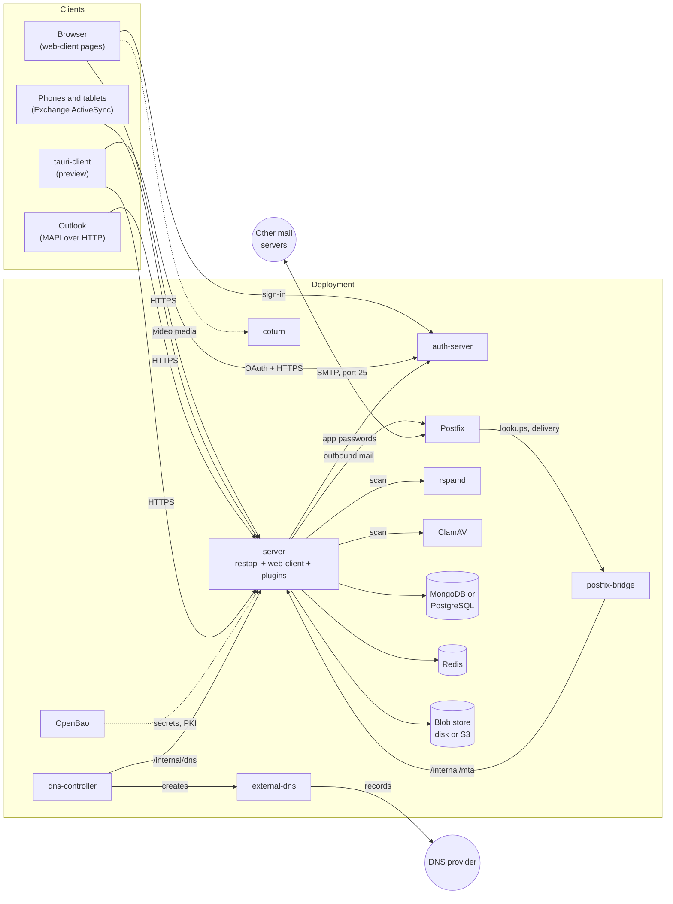
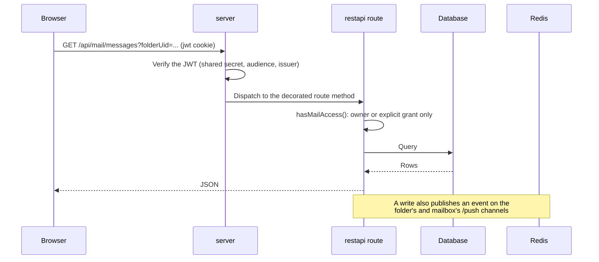
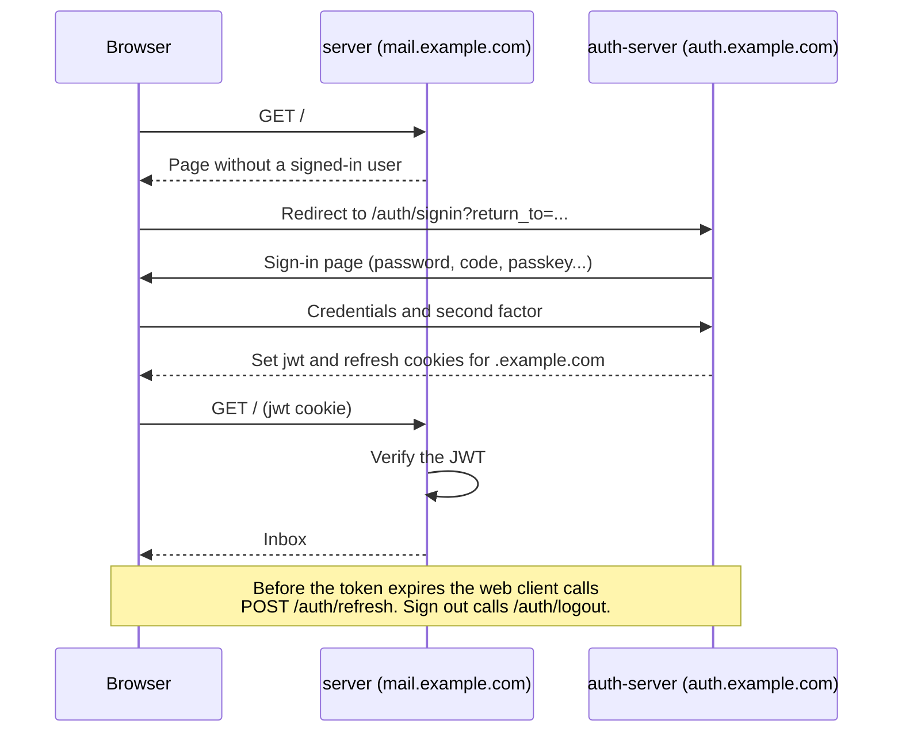
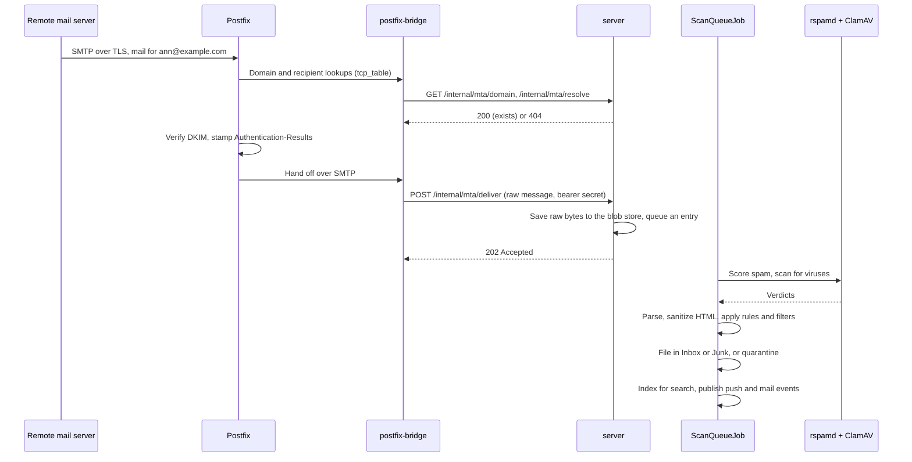
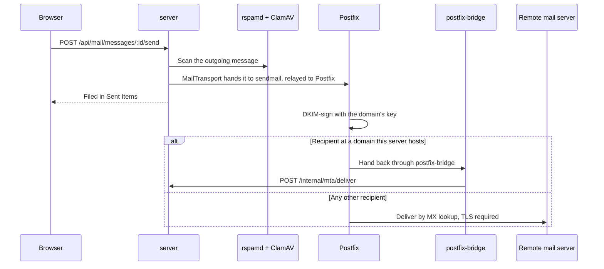

# Architecture

A RapidMX deployment is a handful of cooperating services, not one binary. The mail server itself does not speak SMTP,
does not check passwords and does not store secrets in its own config files. It hands those jobs to Postfix (or Amazon
SES), to the RapidREST auth-server and to OpenBao, and talks to them over narrow, well-defined contracts. Knowing
which piece owns what saves a lot of time when you are chasing a bug: a sign-in problem lives in a different
repository from a delivery problem.

This page is the map. The [Internals](./internals/rest-api.md) section goes deeper into each flow.

## The big picture

## The components

| Component | Repository | What it does |
| --- | --- | --- |
| **server** | `rapidmx/server` | The process a deployment runs. It mounts the REST API, serves and server-side renders the web pages, runs background jobs, loads plugins, and ships the Docker image and Helm chart. |
| **restapi** | `rapidmx/restapi` (`@rapidmx/restapi`) | The core library: data models, the mail REST API, ingestion, scanning, search, encryption key vaults, escrow and compliance. It provides abstract `Base*Route` classes; the server subclasses them for MongoDB and SQL. |
| **web-client** | `rapidmx/web-client` (`@rapidmx/web-client`) | The React UI: webmail (`apps/www`), admin console (`apps/admin`), escrow console (`apps/escrow`), and `lib/`, the API clients, hooks and generic components. `lib/` used to be the separate `@rapidmx/react-shared` package and was merged in. |
| **auth-server** | `rapidrest/auth-server` | Sign-in for every user: passwords, one-time codes, authenticator apps, passkeys, recovery codes, social accounts and app passwords. Built on `@rapidrest/auth`. |
| **Plugins** | one repository each | npm packages the server loads at runtime. ActiveSync, MAPI and Autodiscover give Exchange clients access; booking, meet (video calls), CRM and chat (preview) add features. See [Writing plugins](./plugins/overview.md). |
| **postfix-bridge** | `rapidmx/postfix-bridge` | A small Node service, packaged with its own Postfix, that translates Postfix's lookup tables and SMTP hand-off into the server's HTTP ingest contract. |
| **ses-bridge** | `rapidmx/ses-bridge` | The Amazon SES alternative to postfix-bridge: an outbound `MailTransport` plus a CDK stack (S3 and a Lambda) for inbound mail. |
| **acme** | `rapidmx/acme-server` | A standalone ACME certificate authority for S/MIME certificates (RFC 8555 with the RFC 8823 e-mail challenge), planned for `acme.rapidmx.io`. Its root is **not** publicly trusted. The server's signing-certificate enrollment is a client of any RFC 8823 CA. |
| **dns-controller** | `rapidmx/dns-controller` | Optional. Reads the DNS records the server wants through `/internal/dns` and turns them into one external-dns Deployment per DNS provider config and `DNSEndpoint` resources. It is the only RapidMX component allowed to create or change Kubernetes objects, so the large, internet-facing server stays read-only there. |
| **tauri-client** | `rapidmx/tauri-client` | A preview of the native desktop and mobile app. It signs in through the auth-server with OAuth 2.0 and PKCE and holds several accounts on several servers at once. |
| **rspamd** | third party | Spam scoring, and a Bayes classifier the server teaches when users report junk. |
| **ClamAV** | third party | Virus scanning of messages and attachments. |
| **external-dns** | third party | Writes DNS records to the provider, one instance per provider config, when DNS publishing is on. |
| **MongoDB or PostgreSQL** | third party | All structured data. Every model and route exists in a MongoDB and a SQL variant, and both must work. |
| **Redis** | third party | Cache, rate limits, live notifications for the `/push` WebSocket, and the mail event stream plugins read. Also holds rspamd's classifier statistics. |
| **Blob store** | disk or S3 | Raw messages, bodies, attachments and uploaded images, behind the `BlobStore` interface. |
| **OpenBao** | third party | Optional vault for the deployment's secrets and for the certificate authority that issues users' encryption certificates. |
| **coturn** | third party | A TURN server that relays video-call media for participants who cannot connect directly. |

## Inside the server

The server is a RapidREST application, so most of its wiring is dependency injection.

- **Two processes.** `src/server.ts` is a small supervisor. It starts the real server, `src/worker.ts`, as a child
  process and starts it again when the installed plugins change, because a plugin's classes cannot be unloaded from a
  running Node process.
- **Providers are registered by token.** `restapi` defines interfaces such as `BlobStore`, `SearchProvider`,
  `SpamScanProvider`, `AvScanProvider` and `MailTransport`. The server picks an implementation for each from
  configuration and registers it under that name (`src/lib/registerCoreProviders.ts`). Swapping S3 for local disk, or
  SES for Postfix, is a configuration change, not a code change.
- **Routes are thin subclasses.** `restapi` ships `BaseMailboxRoute`, `BaseMessageRoute` and so on. The server's
  `src/mongo/routes/` and `src/sql/routes/` subclass them and add the `@Route` path. That is why a new API usually
  needs changes in `restapi` first and a small subclass in `server` second.
- **Pages are server-rendered React.** `@rapidrest/react` renders the `web-client` pages on the server and hydrates
  them in the browser. After the first load, the client-side router fetches only the next page's props.
- **Plugins are installed and loaded at start.** `src/plugins/` installs plugin packages from npm (or an uploaded
  tarball), loads their routes, models and jobs, and builds the browser bundles for plugin pages with Vite before the
  server starts serving.

## How an API request flows

Every page and every client talks to the same REST API under `/api`. A request from the web app looks like this:

The access check is the part to remember. Mailbox-scoped routes never use a trusted role to widen access. An
administrator is treated like any other user there, and a mailbox the caller cannot see answers `404`, as if it did
not exist. See [Security](./security.md).

Exchange clients reach the same data through their plugins: `/Microsoft-Server-ActiveSync` (ActiveSync) and `/mapi`
(MAPI over HTTP). Those clients can only send HTTP Basic credentials, so on those paths the server accepts a username
and an app password, which it checks by asking the auth-server, and then treats the token it gets back like any other.

## How a sign-in flows

The server never sees a user's password. The auth-server signs the user in and sets a JWT cookie for the parent
domain, which the server can verify because both share the signing secret.

The admin console asks for the password again before it opens. It needs an *elevated* token, and so do other
sensitive actions. The native app uses a different path: OAuth 2.0 with PKCE against the same auth-server, then a
token exchange for an ordinary session token. [Authentication](./internals/authentication.md) covers both.

## How an inbound message flows

Postfix accepts mail from the internet, but it asks the server, through postfix-bridge, whether each domain and
recipient exists before it accepts anything. A message for an unknown address is refused during the SMTP
conversation, so the server never sends backscatter.

The `/internal/mta` routes are internal only. They require a shared bearer secret, and the chart's public Gateway
answers `404` for `/internal`. With SES the first half is different: SES stores the message in S3 and a Lambda from
ses-bridge calls the same `/internal/mta/resolve` and `/internal/mta/deliver` routes, bouncing recipients that do not
exist. Everything from the queue onward is identical.

For a mailbox using [zero-access encryption](./internals/encryption.md#zero-access-encryption), the queue is skipped. The
server scans and files the message inside the `deliver` request, seals it to the mailbox's key, discards the plaintext and
only then answers the MTA, asking it to retry on a transient failure. See
[Mail flow](./internals/mail-flow.md#zero-access-delivery).

If rspamd or ClamAV cannot be reached, the message is quarantined rather than delivered unscanned. Only `yarn dev`
bypasses an unreachable scanner, and only with a development `NODE_ENV`.

## How an outbound message flows

The server generates each domain's DKIM key pair and shows the public key in the admin console's DNS checklist.
Postfix signs with the private key, which it reads from a volume the server writes to. If the message is encrypted end to
end, with S/MIME or OpenPGP, the browser encrypted it before sending, and the server only relays ciphertext. With a background send
the server answers `202` at once and reports the outcome through push events. With SES, `SesMailTransport` calls the
SES API directly instead of `sendmail`.

## How DNS publishing flows

DNS publishing is optional and off by default (`dns.publishing.enabled`). An administrator creates DNS provider configs
and assigns domains to them. The server records what it wants published and bumps a version counter in Redis. The
controller long-polls `/internal/dns`, authenticating with a projected Kubernetes token that the server checks against the
cluster's service-account keys, and reconciles. A domain with no provider stays manual, and the same function
(`buildDesiredDnsRecords()`) builds both the checklist and the published records, so the two can't disagree. The design is
`specs/dns_publishing_and_integrations.md` in `@rapidmx/restapi`.

## Where state lives

| State | Where |
| --- | --- |
| Mailboxes, folders, message metadata, calendars, contacts, settings, audit log | MongoDB or PostgreSQL |
| Raw messages, bodies, attachments, uploaded images | Blob store (local disk or S3) |
| Cache, rate limits, push notifications, mail event stream, rspamd statistics | Redis |
| Users, credentials, passkeys, app passwords | The auth-server's own database |
| DKIM keys | A volume shared by the server and Postfix |
| Encryption certificate authority | A local volume, or an OpenBao PKI mount |
| Deployment secrets | Kubernetes Secrets, filled from OpenBao when it is enabled |
| Secrets saved in the admin console (DNS credentials, plugin secret settings, API keys, registry tokens) | The database, as AES-256-GCM envelopes |
| The configuration keyring that opens those envelopes | The Secret `<fullname>-config-keyring`, synced from OpenBao's KV when it is enabled. Only the server pods mount it. A production server won't start without it, and a database backup is useless without it. |
| Users' private encryption, signing, OpenPGP and zero-access keys | The user's key vault, wrapped in the browser by a password, recovery code or passkey |
| Sealed zero-access content | Message blobs under `za/<mailbox>/<uid>` in the blob store, sealed fields and index entries in the database |

The database schema is created and updated from the models when the server starts. There are no migration scripts,
so a model change takes effect on the next start, on both backends.

## Next steps

- [Repositories](./repositories.md) lists where each component's code lives.
- [Mail flow](./internals/mail-flow.md), [Authentication](./internals/authentication.md) and
  [Encryption](./internals/encryption.md) go deeper into the flows above.
- [Protocols](./internals/protocols.md) covers ActiveSync, MAPI and Autodiscover.
