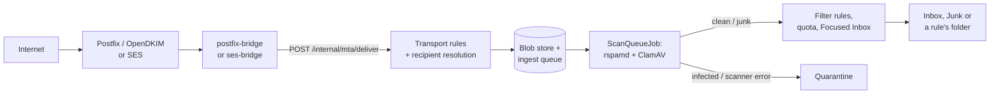

# Mail flow

RapidMX doesn't speak SMTP itself. A dedicated mail transport, Postfix through `postfix-bridge` or Amazon SES through
`ses-bridge`, talks to the internet, and hands messages to the server over a narrow internal HTTP interface. Everything
after that, from scanning to filing a message in a folder, happens in the server, mostly in `@rapidmx/restapi`. This
page follows a message in each direction, so that when you change any step you know what runs before and after it.

For running the transport, see [Mail transport](/docs/operations/mail-transport) in the operator docs.

## Inbound

### The hand-off

The server mounts `@rapidmx/restapi`'s `BaseMailIngestRoute` at `/internal/mta`, outside `/api` and without JWTs:

| Endpoint | Used for |
| --- | --- |
| `GET /internal/mta/domain?name=` | Whether the server accepts mail for a domain (an enabled, verified domain). Postfix uses it as its relay domain list. |
| `GET /internal/mta/resolve?rcpt=` | Whether a recipient exists, so the MTA can reject unknown addresses during the SMTP conversation. |
| `POST /internal/mta/deliver` | The raw message as the body, the envelope in `X-Envelope-From` and `X-Envelope-To` (comma-separated, each address percent-encoded). Answers `202` with a result per recipient. |

The bridges authenticate with a shared secret, `Authorization: Bearer <secret>`, compared in constant time. The secret
is `mail:transport:ingest:secret`, which must be changed from its default and be at least 16 characters outside
development. The server also refuses (403) any `/internal/mta` request that carries a proxy header such as
`X-Forwarded-For`, so the path can't be reached through the public gateway; `mail:internal:allow_forwarded` lifts that
for deployments where the bridge really does come through a proxy, such as the SES ingest load balancer. Repeated wrong
secrets from one address are throttled with a 429. That guard lives in the server (`src/lib/InternalCallerGuard.ts`),
not the library.

A 404 from these endpoints means "reject permanently" to the bridges, which is why the guard answers 403 rather than 404.

### Before the queue

`deliver()` does as little as possible before answering the MTA:

1. **Transport rules** run once per message, before recipients are resolved. They can reject (with a notice only to a
   sender whose DKIM verified, to avoid backscatter), add a header, add a recipient, or mark the message for quarantine.
   If evaluating the rules fails, the message is delivered without them.
2. **Recipients are resolved** in order: a mailbox's primary address, then its aliases (also through domain aliases),
   then a distribution list, then plus-addressing (`user+tag@`, mailboxes only, `mail:plus_addressing:enabled`).
   Distribution lists expand recursively with cycle protection, up to `mail:distribution_lists:max_depth` levels.
   External list members get their copy relayed straight away. An unknown recipient is dropped, and a local sender
   gets a non-delivery report.
3. **The raw message is stored once** in the blob store, and one ingest queue entry is created per mailbox. Their ids are
   derived from the SMTP transaction, so an MTA that retries after a timeout doesn't create duplicates.

### Scanning

`ScanQueueJob` (`mail:jobs:scan_queue:*`, every 10 seconds) picks up queue entries and runs `ScanPipeline`: it parses the
message, asks rspamd for a spam verdict and ClamAV for a virus verdict (on the whole message and on each attachment), and
sanitizes the HTML. Then `resolveDeliveryVerdict()` decides:

| Result | Outcome |
| --- | --- |
| ClamAV finds a virus, or the virus scan fails | Quarantine |
| rspamd says spam or suspect | Junk folder |
| Otherwise | Delivered |
| A transport rule asked for quarantine | Quarantine, whatever the scan said |

**A scanner outage never lets mail through unchecked**, but the two scanners fail differently. When ClamAV can't be
reached, the virus verdict is an error and the message is quarantined. When rspamd can't be reached, the spam verdict is
`SUSPECT` with the symbol `SCAN_ENGINE_UNAVAILABLE`, and the message goes to Junk. Quarantined mail waits for an
administrator in the admin console's quarantine queue. A failed queue entry is retried with backoff
(`max_attempts`, `retry_backoff_seconds`) and stays failed after that, visible in the admin console's ingest queue.

In development (`NODE_ENV` of `dev`, `development` or `test`) a scanner that can't be connected to at all is treated as
clean, with a warning in the log, so you can work without the scanning containers. Any other `NODE_ENV` uses the real
behaviour.

### Delivery

For each mailbox:

1. The mailbox's blocked and safe senders adjust the deliver/junk decision (never quarantine).
2. Control messages are consumed instead of filed: message recalls, read receipts for messages this server sent, and
   ACME challenges for signing certificates (see [Encryption](encryption.md#signing-certificates)).
3. The user's **filter rules** run in order, for mail that isn't junk. They can move, copy, mark read, delete, forward
   or label.
4. The **quota** is charged. A mailbox over quota gets the message quarantined instead.
5. The message is filed, and mail landing in the Inbox is classified as Focused or Other.
6. For delivered mail that isn't junk: the out-of-office reply (at most one per sender per day, never to automated mail),
   meeting invitation processing, and the record of known correspondents that Focused Inbox uses.

Each delivered copy is also appended to the mail event stream as `message.delivered`, which plugins can consume.

### Trusting Authentication-Results

Several decisions depend on whether the sender's DKIM signature verified: members-only distribution lists, the
unsubscribe-by-mail command for lists, Safe Senders, message recall, read receipts, key discovery headers and ACME
challenges. The server doesn't verify DKIM itself. It reads the `Authentication-Results` header the inbound MTA stamps,
and it trusts only the header whose authserv-id matches `mail:security:trusted_authserv_id` (Helm `mail.trustedAuthservId`,
which defaults to the bundled Postfix's host name, where OpenDKIM verifies).

While that setting is empty, **no sender counts as verified**. Members-only lists then drop everything, copies relayed by
lists and forwarding rules get a rewritten From, and forwarded invitations are refused. This fails closed by design. The
MTA is responsible for removing forged `Authentication-Results` headers that carry its own authserv-id before it adds
its own.

## DKIM signing

The server generates the keys; the MTA signs. When a domain is created or verified, the server writes a 2048-bit RSA key
for it to `mail:dkim:key_dir` (`<domain>.<selector>.key`, selector `mail` by default) and stores the public half on the
domain for the DNS checklist. With the Helm chart that directory is a volume shared with postfix-bridge, which copies new
keys into OpenDKIM and signs outbound mail with them. With SES, SES's own DKIM signs instead.

## Outbound

### Sending

`POST /api/mail/messages/:id/send` sends a draft. The send path (`scanAndRelay()` in `src/util/MailSendUtils.ts`) is the
same for the web app, ActiveSync and MAPI:

1. Add a `Message-ID` if the message has none, and check that the From and Sender headers are addresses the caller may
   send as (403 otherwise).
2. Scan the message. Spam or malware, or a scanner that couldn't run, refuses the send with a 422. Outbound mail is
   never sent unscanned.
3. Hand it to the configured `MailTransport`. If no recipient is accepted, the send fails with a 502 that lists why.
4. File the message in Sent Items, and publish `message.sent` (and `send.failed` for refused recipients) to the mail
   event stream.

The route is rate-limited per user. Mail the server generates itself (out-of-office replies, list relays, notices)
goes to the transport directly.

### Background and scheduled send

With `{ "background": true }` in the body, the send route answers `202` straight away and the message moves to the
Outbox. `ScheduledSendJob` (`mail:jobs:scheduled_send:*`) finishes it, the same job that sends messages scheduled for
later. Its outcome is published to the mailbox and folder channels as `send-succeeded`, `send-retrying` or
`send-failed` events. A message the mail system refuses outright, or that fails the scan, is marked failed at once and
stays in the Outbox; a temporary failure is retried with backoff. A server that stops mid-send leaves the message for the
job to finish after restart, and it is never sent twice. `concurrency` (default 4) is how many messages are scanned and
relayed at once, and `drain_ms` how long a shutdown waits for them.

### Transports

`MailTransport` (`src/transport/MailTransport.ts`) is a single `send({ raw, envelopeFrom, envelopeTo })` that reports the
accepted and refused recipients. Retries, queueing and DKIM are the MTA's job. Two implementations, chosen by
`mail:transport:provider`:

- `postfix` (the default): `PostfixSendmailTransport` runs `mail:transport:sendmail:path`. In the container image that
  is msmtp, configured to relay to postfix-bridge's Postfix (`mail.relay.*` in the chart).
- `ses`: `SesMailTransport` calls the SES v2 API with the pod's AWS credentials.

In development, when there is no sendmail binary, the server delivers sent mail straight into its own mailboxes through
the ingest path, and refuses external recipients. That lets you test sending without any MTA.

### Bounces, receipts and recall

- A synchronous send that fails answers with the reasons. A failure found later, or a partial one, files a standard
  delivery status notification from `postmaster@<domain>` in the sender's Inbox. Bounces from the internet come back
  through `/internal/mta/deliver` with an empty envelope sender, like any other mail.
- Delivery and read receipts are sent automatically or held for the user's approval, depending on the mailbox's
  settings for internal, federated and external senders.
- `POST /api/mail/messages/:id/recall` sends a recall for a message in Sent Items. A RapidMX server honours it only when
  the recall's DKIM signature verified.

## Where to look

| Step | Code |
| --- | --- |
| Ingest endpoints, resolution, delivery | `@rapidmx/restapi` `src/routes/BaseMailIngestRoute.ts` |
| Ingest guard | server `src/lib/InternalCallerGuard.ts` |
| Scanning and verdicts | `@rapidmx/restapi` `src/scan/ScanPipeline.ts`, `src/jobs/ScanQueueJob.ts` |
| Send path | `@rapidmx/restapi` `src/util/MailSendUtils.ts`, `src/routes/BaseMessageRoute.ts` |
| Background and scheduled send | `@rapidmx/restapi` `src/jobs/ScheduledSendJob.ts` |
| Transports | `@rapidmx/restapi` `src/transport/` |
| Mail event stream | `@rapidmx/restapi` `src/events/MailEventStream.ts` |
| DKIM keys | `@rapidmx/restapi` `src/dkim/FsDkimKeyProvider.ts` |
| Development shortcuts | server `src/dev/` |
