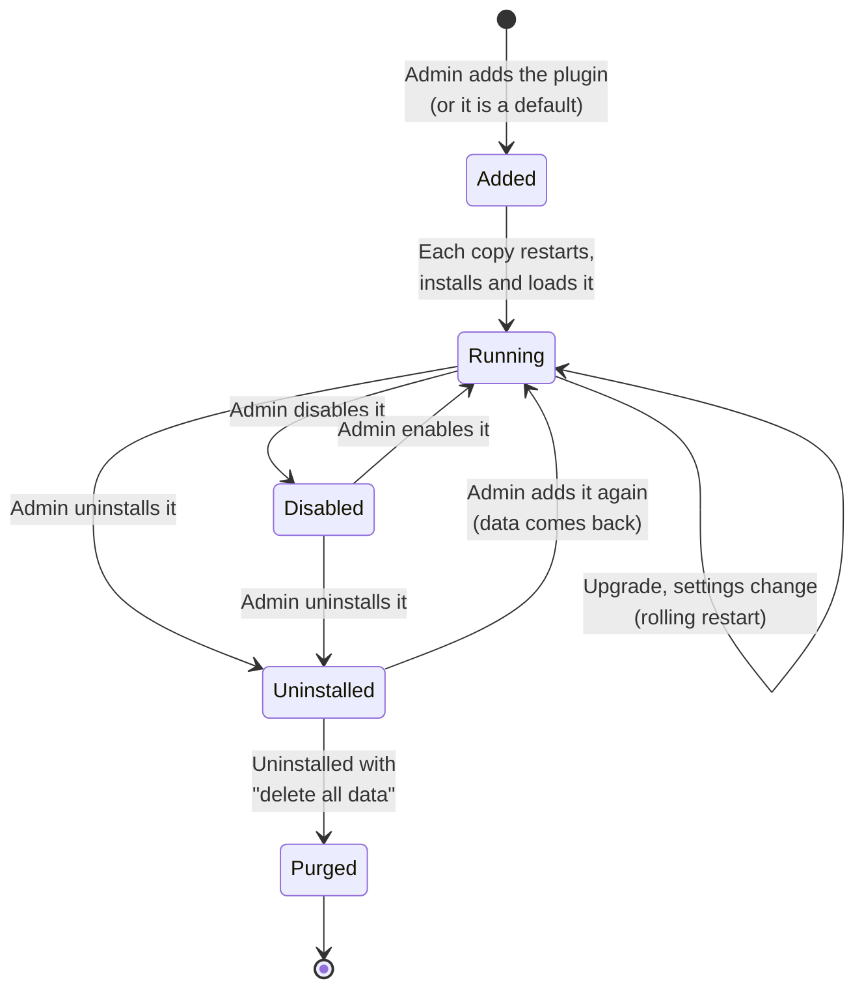

# Plugin overview

A RapidMX server does mail, calendar, contacts and tasks on its own. Everything beyond that core ships as a plugin: Exchange
ActiveSync for phones, MAPI over HTTP for Outlook, Autodiscover, public booking pages, video meetings and the CRM are all
plugins, built exactly the way you would build your own. If you want to give every user of a deployment a new app, connect
the server to a company system, or add an admin page for something your organization needs, a plugin is how you do it
without forking the server.

This page explains what a plugin is and what happens to it inside the server. [Create a plugin](create-a-plugin.md) then
walks you through building one.

## What a plugin is

A plugin is an ordinary npm package with two extra things:

- a `rapidmx.plugin` block in its `package.json` (the **manifest**), which names the plugin and declares its settings,
  its pages and the other plugins it needs;
- one **entry point per database backend**, `./mongo` and `./sql` in the package's `exports`, each exporting the
  ready-to-use classes for that backend.

The server runs on either MongoDB or a SQL database (PostgreSQL in the published deployments) and imports only the entry point
that matches its own datastore. A plugin therefore ships both, the same way the server's own `@rapidmx/restapi` library
does.

## What a plugin can add

| What | How the plugin provides it |
| --- | --- |
| API routes | Route classes decorated with RapidREST's `@ApiRoute` or `@Route`, exported from the entry points. See [Routes and models](routes-and-models.md). |
| Data models | `@DataStore` model classes, a Mongo and a SQL twin of each. The server creates their collections and tables. |
| Background jobs | Concrete `BackgroundService` subclasses exported from the entry points. The server starts them with its own jobs. |
| Pages | Browser apps shipped as TSX sources and declared under `ui.apps`. The server builds and serves them. See [Pages and navigation](pages-and-navigation.md). |
| Navigation | Entries in the web app's app rail, the Settings sidebar and the admin console's navigation (`ui.appRail`, `ui.settingsSections`, `ui.adminNav`). |
| Admin settings | Settings declared in the manifest, which administrators edit in the admin console. See [Settings](settings.md). |
| Clean-up on uninstall | An optional `./purge` entry point with an `onPurge` hook. See [Data and uninstalling](data-and-uninstall.md). |

Everything server-side is plain RapidREST: the server's class loader registers every export of the entry point exactly
as it registers its own classes, so routes, models and jobs get dependency injection, configuration and ACLs the usual
way. If decorator-driven routes and models are new to you, read
[Defining routes](https://rapidrest.dev/docs/routing/controllers/defining-routes) and
[Models and persistence](https://rapidrest.dev/docs/models-persistence) on rapidrest.dev first.

A plugin runs inside the server process with the server's full privileges. There is no sandbox. That is why only
administrators with a recently confirmed sign-in can add one, and why the server only installs packages its operator
allows (see [How the server finds plugins](#how-the-server-finds-plugins)).

## The plugins that already exist

These are good references, because each one exercises a different part of the contract:

| Package | What it shows |
| --- | --- |
| `@rapidmx/autodiscover-plugin` | The smallest real plugin: one route per backend and one setting. Start reading here. |
| `@rapidmx/mapi-plugin` | Routes only, with short-lived state in the cache. |
| `@rapidmx/activesync-plugin` | Routes plus its own models for sync state. |
| `@rapidmx/booking-plugin` | Models, routes, a public app, a Settings page, a Settings sidebar entry and an `onPurge` hook. |
| `@rapidmx/meet-plugin` | A public app with an app rail entry that only shows for some users (`resolveFrom`), and secret settings. |
| `@rapidmx/crm-plugin` | The largest: many models, background jobs, four apps on three hosts, admin console navigation. |
| `@rapidmx/chat-plugin` | A preview that is not published yet. |

ActiveSync, Autodiscover, Booking, MAPI and Meet are the **default plugins**: the server adds them the first time it starts
against an empty database (`system:plugins:defaults`).

## How the server finds plugins

The installed plugins are rows in the server's `Plugin` table, not files on disk. An administrator adds, upgrades,
enables, disables and uninstalls them on the admin console's **Plugins** page (or through `/api/system/plugins`), and
every change is a database write. Each server copy then brings itself in line with the table.

Three configuration keys decide what may be installed at all:

| Key | Default | Meaning |
| --- | --- | --- |
| `system:plugins:namespaces` | `["@rapidmx"]` | npm scopes the admin console searches for plugins (packages named `*-plugin`). Packages in these scopes may be added. An entry can name its own registry and token. |
| `system:plugins:allowed_packages` | `["@rapidmx/*"]` | Further package names or scoped wildcards (`@acme/*`) an administrator may add. |
| `system:plugins:registry` | `https://registry.npmjs.org` | The registry everything else comes from (`registry_token` for a private one). |

A package outside those lists can't be added from the registry, and a row that names one (say, written straight into the
database) is refused when the server loads plugins. Only the server's configuration can widen the list, never the admin
console. The one exception is a plugin an administrator **uploads** as an `npm pack` file: the administrator vouches for
that code, so it skips the allow-list. [Publishing](publishing.md) covers what this means for a third-party plugin.

## How a server copy loads plugins

Every server copy prepares its plugins before it starts serving:

1. **Read the plugin table**, adding any default plugin that has never had a row. A default plugin an administrator
   removed keeps a removed row, so it is never added again.
2. **Install** the enabled plugins with npm into `system:plugins:dir` (`/app/plugins` in the container image). npm runs
   with `--ignore-scripts`, so a plugin's install scripts never run, and without installing peer dependencies.
3. **Check** each installed package: the exact version and the integrity hash recorded when it was added, a valid
   manifest with `apiVersion` 1, an entry point for this server's datastore, and that it uses the server's own copies of
   `@rapidrest/core`, `@rapidrest/service-core` and `@rapidmx/restapi` rather than bringing its own.
4. **Order** the plugins so each one loads after the plugins it `requires`, and skip any whose requirements are missing.
5. **Apply saved settings** to the configuration, before any plugin class is created, so the plugin's `@Config` fields
   see them.
6. **Build plugin pages.** When an enabled plugin has UI apps, the server builds the browser bundles with Vite, together
   with its own web app, into `system:plugins:dir`'s `.ui-build` folder. A build is reused until the set of plugins with
   UI, their versions or the server's web client change.
7. **Load** the entry points. The class loader imports each plugin's `./mongo` or `./sql` and registers every export,
   then the server connects models, mounts routes and starts jobs as usual.

None of these steps can stop the server from starting. A plugin that fails to install, fails a check, fails to import or
fails to build its pages is left out and reported on the admin console's Plugins page and in the server log, and the rest
load. If the server fails to start twice in a row after loading plugins, it starts once in **safe mode**, with no plugins
at all, and tries them again later with a growing delay.

## What happens when plugins change

A change to the plugin set needs a fresh process, because models and jobs are only set up when the server starts and
Node caches ES module imports. So the server process a deployment runs is a small supervisor that starts the real server
as a child process and starts it again whenever the child asks to be restarted.

Each copy watches the plugin table, both through a `plugins.changed` message on the events Redis and by polling. When the
set it loaded no longer matches the table, it restarts. With a cache Redis configured, copies take a shared restart lock
so they restart one at a time and mail keeps flowing. Before stopping, a copy reports itself not ready
(`GET /api/status` answers 503) for a while so the load balancer stops sending it requests. Each copy also publishes what
it loaded, which is how the admin console shows per-server status.

Saving a plugin's settings is a change to the table too, so it restarts the servers in the same way.

## Lifecycle at a glance

Uninstalling keeps the plugin's data unless the administrator asks for it to be deleted. That deletion, and how a plugin
takes part in it, is covered in [Data and uninstalling](data-and-uninstall.md).

## Where to go next

- [Create a plugin](create-a-plugin.md) builds a working plugin step by step.
- [Plugins](/docs/administration/plugins) in the administrator docs shows the same system from the admin console.
- [Architecture](../architecture.md) places plugins among the server's other parts.
