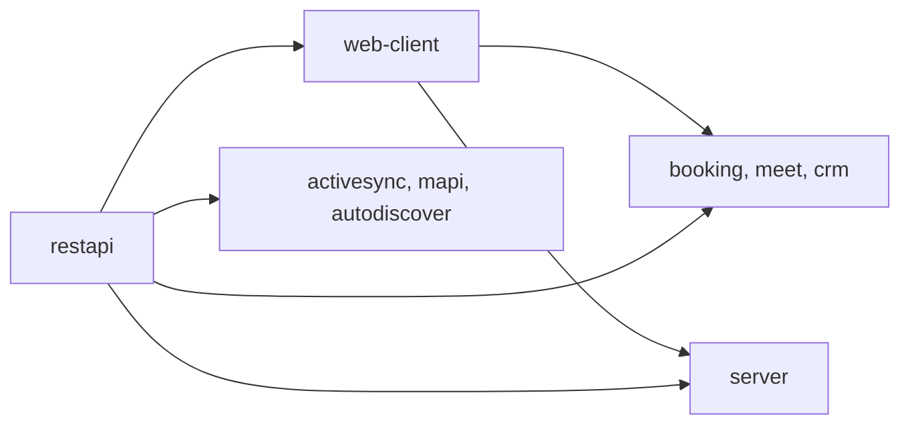

# Releasing

Releases are cut by the maintainer, not by contributors. You don't need to bump a version or touch `CHANGELOG.md` in a
pull request, and you shouldn't: the release tool does both, and a hand edit gets in its way. This page explains what
happens after your change is merged, so you know when it will reach a package or an image, and what to put in
`RELEASE_NOTES.md` if your change needs more than a changelog line.

## What a contributor provides

- **Commit messages in the release format.** They become the changelog. See [Commit messages](./commit-messages.md).
- **Release notes, when they help.** `RELEASE_NOTES.md` is written by hand. If your change adds an API, changes
  behaviour an integrator relies on, or needs upgrade steps, add a short entry under the `## Unreleased` heading at the
  top. Leave the heading itself in place: the release tool needs it.
- **No version changes.** Leave `version` in `package.json`, the Helm chart and the README as they are.

## The release command

Every repository has a `release` script that runs [`rapidrest release`](https://rapidrest.dev/docs/cli-reference)
from `@rapidrest/cli`:

```bash
yarn release minor
yarn release prerelease            # the next 1.0.0-beta.N
yarn release 2.1.0 --dry-run       # print the computed version and stop
yarn release patch --no-push       # commit and tag locally only
```

The bump is a semver strategy (`major`, `minor`, `patch`, `premajor`, `preminor`, `prepatch`, `prerelease`, with
`--preid` for the `pre*` ones) or an explicit version. The command refuses to run on a working tree with uncommitted
changes. It then:

1. Computes the new version and writes it to `package.json`.
2. Inserts a `## v<version>` heading directly below `RELEASE_NOTES.md`'s `## Unreleased` heading, so the notes
   written there become this version's notes. It fails before changing anything if that heading is missing.
3. Builds a new `CHANGELOG.md` entry from every commit message since the last tag (merge commits excluded).
4. If the repository has a Helm chart under `helm/`, sets `service.image.tag` in `values.yaml` and `appVersion` in
   `Chart.yaml`. It also updates `VERSION=` in `single_node_install.sh`, and in `README.md` the Docker Image table's
   `Tag` row and the `--version` of the chart's own `oci://.../charts/<name>` reference, where those exist.
5. Commits the result with the version as the message, tags it `v<version>`, and pushes both.

Step 4 finds each value by its position (a YAML key, a table row, an assignment), never by searching for the old
version string. The RapidMX projects are meant to share version numbers, so a README can legitimately mention another
project at the same version as this one, and a text replacement would rewrite it.

## Wait for green CI first

The maintainer pushes the commits to be released and waits for that push's CI run to succeed **before** running the
release command. Tagging first and diagnosing afterwards means the fix lands on top of a release that is already
tagged and published. A local test run is not a substitute: CI's environment and thresholds are the ones that count.

## What publishing does

Pushing the tag starts the publish job:

| Repository kind | What is published | Where |
| --- | --- | --- |
| Libraries and plugins (`restapi`, `web-client`, the plugins) | The npm package | npm, from GitHub Actions with OIDC. A prerelease version (`1.0.0-beta.N`) goes to the `next` dist-tag, anything else to `latest`. Only a tag on `main` whose Build workflow succeeded is published. |
| `server`, `postfix-bridge`, `acme-server` | The container image and the Helm chart | `ghcr.io/rapidmx/<name>` and `oci://ghcr.io/rapidmx/charts`, once the tag's CI run has passed its build and smoke tests. |

Publish jobs run in a protected `publish` environment.

## Releasing a change that spans repositories

Repositories depend on each other through published versions, so a cross-repository change ships in dependency order:



For each repository in turn: release it, then raise the dependency range in the next one (`"@rapidmx/restapi":
"^0.34.0"`), push, wait for green CI, and release that.

**A downstream release bumps at least as much as the upstream release it picks up.** If `web-client` went from 0.15.1
to 0.16.0 (a minor), a plugin that moves to it gets a minor release too, even if the plugin's own diff is only the
dependency bump: it now behaves differently from its previous version. A patch upstream means a patch downstream, a
major means a major. Repositories on a prerelease line, like `server`'s betas, stay on it.
