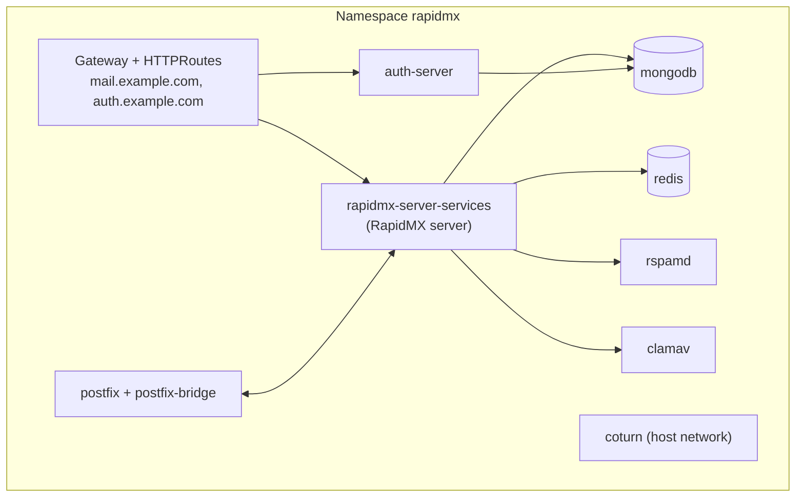

# Kubernetes (Helm)

If you already run a Kubernetes cluster, one Helm chart installs all of RapidMX: the server, the auth-server, MongoDB,
Redis, rspamd, ClamAV, Postfix with postfix-bridge, and coturn for video calls. It creates a Gateway for each of its
two host names and has cert-manager issue their Let's Encrypt certificates. Domains you add later in the admin console
work within seconds, with nothing to restart or upgrade.

This page is the short path to a working install. The [Helm chart reference](../operations/helm-chart.md) lists every
value, and [Secrets and OpenBao](../operations/secrets-and-openbao.md) covers keeping secrets in a vault.

## What you need

- A cluster, `kubectl` and Helm 3.8 or later (3.14 or later for upgrades, see [Upgrading](../operations/upgrading.md))
- A default `StorageClass`
- A [Gateway API](https://gateway-api.sigs.k8s.io/) controller with a `GatewayClass`, such as
  [Envoy Gateway](https://gateway.envoyproxy.io/). The chart expects the class `envoy`; change it with
  `global.gateway.className`.
- [cert-manager](https://cert-manager.io/) with Gateway API support turned on (`--set config.enableGatewayAPI=true`),
  for Let's Encrypt certificates
- A way to expose port 25: the chart's `postfix` Service is of type `LoadBalancer`
- The DNS records and open ports from [Before you deploy](before-you-deploy.md)

The chart grants itself only namespace-scoped permissions (a `Role`, never a `ClusterRole`), so installing it needs no
cluster-wide rights beyond what Helm needs to create the namespace.

## Install

1. Check the cluster is ready:

   ```bash
   kubectl get nodes
   kubectl get gatewayclass
   helm version --short
   ```

   `kubectl get gatewayclass` should list your class (for example `envoy`) as accepted.

2. Install the chart. Replace `example.com` with your domain:

   ```bash
   helm upgrade --install --create-namespace --namespace rapidmx rapidmx \
     oci://ghcr.io/rapidmx/charts/server --version 1.0.0-beta.43 \
     --set global.domain=example.com \
     --set global.jwt.secret="$(openssl rand -hex 32)" \
     --set global.mailIngestSecret="$(openssl rand -hex 32)"
   ```

   - `global.domain` is your mail domain. From it, the web app becomes `mail.example.com` and sign-in
     `auth.example.com`.
   - `global.jwt.secret` is shared by the server and the auth-server. `global.mailIngestSecret` is shared by the server
     and postfix-bridge. Both are required, and the render fails without them.

   :::warning Keep both secrets
   An upgrade needs the same two values, or `--reset-then-reuse-values`. If you lose them, you can read them back from
   the cluster, as shown in [Upgrading](../operations/upgrading.md).
   :::

3. Watch it start. Every pod should reach `Running`. ClamAV takes a few minutes to load its signatures:

   ```bash
   kubectl -n rapidmx get pods --watch
   ```

4. Find the addresses for your DNS records:

   ```bash
   kubectl -n rapidmx get gateway
   kubectl -n rapidmx get svc postfix
   ```

   Point `mail.example.com` and `auth.example.com` at the Gateway's address. Postfix must be reachable on
   `mail.example.com` too, because that is the name other mail servers connect to.

   :::tip Good to know
   If the Gateway and the `postfix` Service get different addresses, give Postfix a name of its own: add
   `--set postfixBridge.hostname=mx.example.com --set postfixBridge.tls.certManager.enabled=false` to the install,
   point `mx.example.com` at the `postfix` Service and use it as your MX record. Postfix then uses a self-signed
   certificate.
   :::

5. Wait for the certificates to be issued (`READY` is `True`):

   ```bash
   kubectl -n rapidmx get certificate
   ```

   ```text
   NAME               READY   SECRET                      AGE
   auth.example.com   True    auth.example.com-tls-cert   41h
   mail.example.com   True    mail.example.com-tls-cert   41h
   ```

6. Read the `admin` account's password:

   ```bash
   kubectl -n rapidmx get secret rapidmx-authserver-service-secrets -o jsonpath='{.data.default_accounts}' \
     | base64 -d | tr -d '\\' | sed -n 's/.*"password":"\([^"]*\)".*/\1/p'
   ```

7. Open `https://mail.example.com` and continue with [First-time setup](first-time-setup.md).

## What the chart installs



The [Helm chart reference](../operations/helm-chart.md#architecture) explains each part, and which volumes hold data
you must back up.

## Common variations

| To... | Set |
| --- | --- |
| Use a Gateway you already have | `global.gateway.name` and `global.gateway.namespace`. The Gateway needs an HTTPS listener per host that terminates TLS with the `<host>-tls-cert` Secret, which the chart lets it read through a `ReferenceGrant`. |
| Use different host names | `host` and `global.serverHost` (to the same value), and `authserver.host` |
| Keep secrets in OpenBao | `global.openbao.enabled=true` and the rest of [Secrets and OpenBao](../operations/secrets-and-openbao.md) |
| Send through Amazon SES | `mail.transport.provider=ses` and `postfixBridge.create=false`, see [Mail transport](../operations/mail-transport.md) |
| Turn off the TURN server | `coturn.create=false`, see [Video calls: the TURN relay](../operations/video-relay.md) |
| Install from a checkout | `helm repo add bitnami https://charts.bitnami.com/bitnami`, then `helm dep up ./helm`, and use `./helm` in place of the `oci://` address |

:::note
The chart can also run the server on PostgreSQL instead of MongoDB (`postgresql.create`, `global.database.type`; it
refuses to render with both databases on). None of the installers use that path, so this guide documents MongoDB only.
If you do choose PostgreSQL, read the PostgreSQL warnings in [Upgrading](../operations/upgrading.md) first.
:::

## Next steps

- [First-time setup](first-time-setup.md)
- [Backup and restore](../operations/backup-and-restore.md): know what to back up before you rely on it.
- [Monitoring](../operations/monitoring.md)
