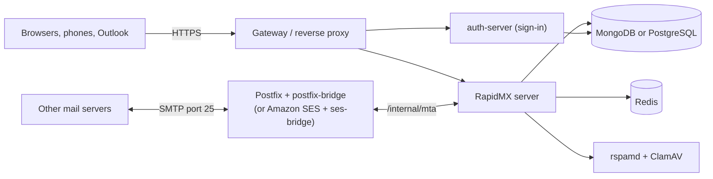

# Choose a deployment

RapidMX runs as a small group of services: the RapidMX server (web app, API, Exchange ActiveSync and MAPI), the
auth-server that handles sign-in, a database, Redis, the rspamd spam filter, the ClamAV virus scanner and a mail
transport that talks to the rest of the internet. You don't assemble these yourself. Each deployment option below
installs all of them and wires them together, so the real choice is *where* they run and *how mail gets in and out*.

All four options finish in the same place: you open the web app, sign in as `admin` and run the setup wizard described
in [First-time setup](first-time-setup.md).

## The four options

| I want to... | Use | Mail transport | HTTPS |
| --- | --- | --- | --- |
| Try RapidMX on my own computer | [Docker Compose](docker-compose.md) | Optional (postfix-bridge) | Bring your own |
| Run it on a Kubernetes cluster I already have | [Kubernetes (Helm)](kubernetes.md) | Postfix, installed with the chart | Let's Encrypt |
| Run it on one Linux server, with one command | [Single server (k3s)](single-server.md) | Postfix, installed for you | Let's Encrypt |
| Run it on AWS | [AWS (CloudFormation)](aws.md) | Amazon SES | Let's Encrypt |

### Docker Compose

Best for evaluating RapidMX on a laptop or workstation. Everything runs locally and listens on `127.0.0.1` only. It
builds the server image from a checkout of the source, starts in development mode with placeholder secrets, and can't
send or receive real mail until you add a mail server. A production variant exists, but you have to provide HTTPS and
keep the Postfix stack's domain list in step with the admin console yourself.

### Kubernetes (Helm)

Best when you already operate a cluster. One Helm chart installs the server, the auth-server, MongoDB (or
PostgreSQL), Redis, rspamd, ClamAV, Postfix with postfix-bridge, and a TURN server for video calls. It needs a Gateway
API controller (Envoy Gateway by default) and cert-manager, which you install first. Domains you add in the admin
console work within seconds, with nothing to restart.

### Single server (k3s)

Best for one Linux server, such as a rented VPS or a machine in your office. A single script installs k3s (a small
Kubernetes distribution), Envoy Gateway, nginx in front of it, cert-manager, OpenBao for secrets and then the same Helm
chart as above. You get the Kubernetes deployment without having to run Kubernetes yourself.

### AWS (CloudFormation)

Best when your infrastructure lives in AWS. One CloudFormation stack creates the network, an EC2 instance and
everything on it, with Classic Load Balancers in front and EBS volumes behind. Mail goes through Amazon SES instead
of Postfix, which avoids the port 25 restrictions most cloud providers apply, but needs a second small stack
(ses-bridge) for inbound mail.

## How the pieces fit

Whichever option you choose, the running system looks like this:

The web app and sign-in page are served on two host names, by default `mail.example.com` and `auth.example.com`. Mail
arrives at Postfix (or SES), which hands each message to the server over an internal API that the public gateway never
exposes. Outgoing mail takes the reverse path. [Mail transport](../operations/mail-transport.md) explains this in
detail.

:::note
There is no IMAP or POP3. People read their mail in the web app, on phones and tablets through Exchange ActiveSync, in
Outlook through MAPI over HTTP, or in the RapidMX desktop and mobile app (currently a preview). See [Connect your apps](../clients/overview.md).
:::

## Before you choose

- Every option except Docker Compose on your own computer needs a domain, two DNS records, open ports and ideally a
  reverse DNS record. Read [Before you deploy](before-you-deploy.md) first.
- The Kubernetes, k3s and AWS options install the published container image and Helm chart from the GitHub Container
  Registry (`ghcr.io/rapidmx/server` and `oci://ghcr.io/rapidmx/charts/server`), so there is nothing to clone or build.
  Docker Compose builds from a checkout of [github.com/rapidmx/server](https://github.com/rapidmx/server).
- RapidMX is pre-release software (version `1.0.0-beta.43` at the time of writing). Back up before every upgrade, as
  described in [Upgrading](../operations/upgrading.md).
