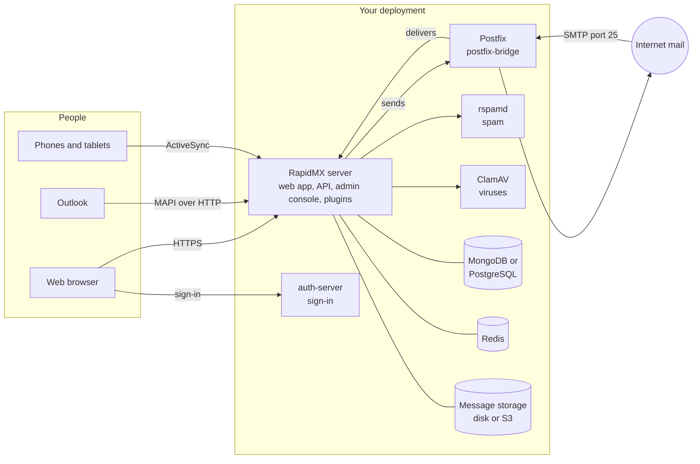

# What is RapidMX?

RapidMX is a mail and collaboration server that you run yourself. One deployment gives a whole
organization email, calendars, contacts and tasks, with end-to-end encryption, spam and virus
scanning, and an admin console for as many mail domains as you host. Optional plugins add video
meetings, public booking pages, a CRM and more.

It exists for organizations that want what a hosted suite gives them, without their mail living in
someone else's cloud. Your messages, keys and logs stay on infrastructure you choose, and the code
that handles them is open source under the Mozilla Public License 2.0.

:::note RapidMX is in public beta
Releases are versioned `1.0.0-beta.N` on the way to 1.0. It handles real mail for real domains, but
expect frequent releases, and read the [upgrade notes](operations/upgrading.md) before each one.
:::

## How people use it

Most people never think about the server at all. They use one of these:

- **The web app** at `https://mail.example.com`, for mail, calendar, contacts, tasks and settings.
  This is also where the admin console lives.
- **Outlook for Windows**, which connects over MAPI over HTTP, the same protocol it uses with
  Exchange. This is still being finished; see [Outlook](clients/outlook.md) for its current state.
- **The built-in mail apps on iPhone, iPad and Android**, which connect over Exchange ActiveSync and
  sync mail, contacts, calendars and tasks.

Autodiscover lets Outlook and phones configure themselves from just an email address and password.
RapidMX does not offer IMAP or POP3. See [Connect your apps](clients/overview.md) for the details.

## What's in a deployment

A RapidMX installation is a small set of services that work together. The installers and the Helm
chart set all of them up for you, so this is here to help you understand what you're running rather
than something you have to assemble.

| Component | What it does |
| --- | --- |
| **RapidMX server** | Serves the web app and admin console, the REST API, and the ActiveSync, MAPI and Autodiscover endpoints. Stores and indexes mail, runs scheduled jobs, and loads plugins. |
| **auth-server** | The sign-in page and account management: passwords, one-time codes, authenticator apps, passkeys, social sign-in and app passwords. |
| **Postfix** (via postfix-bridge) | Talks SMTP to the rest of the internet. It hands incoming mail to the server and relays outgoing mail, signing it with DKIM. On AWS, Amazon SES and ses-bridge take this role. |
| **rspamd** and **ClamAV** | Score every message for spam and scan it for viruses. In production a scanner outage never lets mail through unchecked: with ClamAV down a message is quarantined, with rspamd down it goes to Junk. |
| **MongoDB or PostgreSQL**, **Redis** | The database, and a cache and message bus shared by the server's copies. |
| **Message storage** | Message bodies and attachments, on a volume or in S3-compatible storage. |
| **OpenBao** (optional) | Keeps the deployment's secrets and the encryption certificate authority's key in a vault. |
| **coturn** (optional) | Relays video-call media for participants behind strict firewalls. |

## Find your way around

- **Setting up a server?** Start with [Choose a deployment](getting-started/overview.md), then follow
  [First-time setup](getting-started/first-time-setup.md) to add your domain and first mailbox.
- **Connecting a phone or Outlook?** See [Connect your apps](clients/overview.md).
- **Using RapidMX day to day?** The [user guide](user-guide/mail.md) covers mail, calendar,
  contacts, encryption and the rest, in plain language.
- **Running it for your organization?** [Administration](administration/admin-console.md) covers the
  admin console, and [Operations](operations/upgrading.md) covers upgrades, backups, monitoring and
  troubleshooting.
- **Want to contribute or write a plugin?** Head to the [developer guide](/developers/intro).
