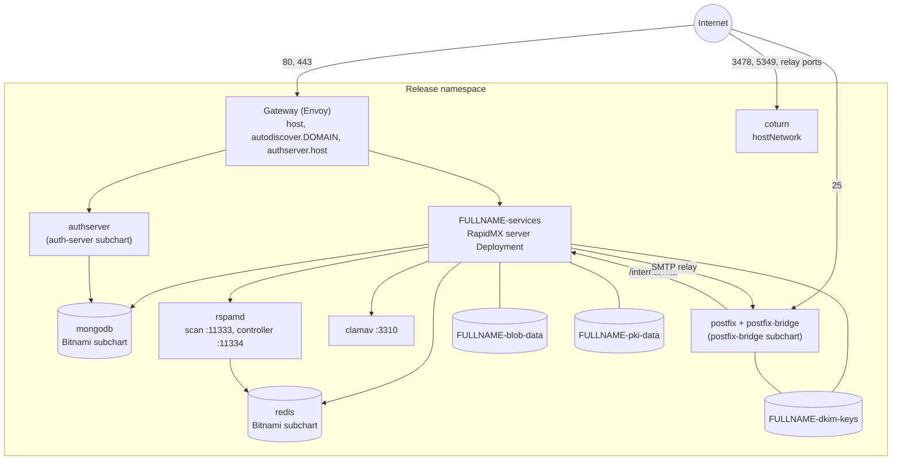

# Helm chart reference

The RapidMX server chart (`oci://ghcr.io/rapidmx/charts/server`) installs the RapidMX server together with everything
it depends on. The [Kubernetes](../getting-started/kubernetes.md), [single server](../getting-started/single-server.md)
and [AWS](../getting-started/aws.md) options all use it; the two installers just choose its values for you. This page
is the full reference: how the pieces fit, what the chart expects to find in the cluster, the behaviour behind the
less obvious values, and a table of every value with its default.

## TL;DR

```bash
helm upgrade --install --create-namespace --namespace rapidmx rapidmx \
  oci://ghcr.io/rapidmx/charts/server --version 1.0.0-beta.43 \
  --set global.domain=example.com \
  --set global.jwt.secret="$(openssl rand -hex 32)" \
  --set global.mailIngestSecret="$(openssl rand -hex 32)"
```

## Architecture



| Component | What it does | Created by |
| --- | --- | --- |
| RapidMX server | The web app, admin console, REST API, Exchange ActiveSync and MAPI (as plugins). A Deployment named `<fullname>-services` behind a Service of the same name on port 80. | This chart |
| auth-server | Sign-in, accounts, two-factor, app passwords. Served on `authserver.host`. | `authserver` subchart (`oci://ghcr.io/rapidrest/charts/auth-server`) |
| MongoDB | The database for both the server and the auth-server. PostgreSQL can replace it. | Bitnami `mongodb` subchart |
| Redis | Cache, events and the rspamd classifier's statistics. | Bitnami `redis` subchart |
| rspamd | Spam scoring, and learning from users' junk reports. | This chart |
| ClamAV | Virus scanning. | This chart |
| Postfix and postfix-bridge | Inbound and outbound SMTP on port 25, DKIM signing. | `postfixBridge` subchart (`oci://ghcr.io/rapidmx/charts/postfix-bridge`) |
| coturn | TURN relay for video calls, on the node's own network. | This chart |
| Gateway, HTTPRoutes, Issuer, Certificates | HTTPS for `host`, `autodiscover.<domain>` and `authserver.host`, with Let's Encrypt certificates. | This chart and the auth-server subchart |

`<fullname>` is the release name, followed by `-server` unless the release name already contains `server`. A release
named `rapidmx` gives `rapidmx-server`; a release named `rapidmx-server` gives `rapidmx-server`.

The public Gateway answers `404` for `/internal`. The MTA hand-off API is reached only inside the cluster, through the
`<fullname>-services` Service, or through the optional internal load balancer (`mail.ingestService`) for ses-bridge.

## Prerequisites

- Kubernetes with a default `StorageClass` (or `global.storageClass`)
- Helm 3.8 or later. Upgrades with `--reset-then-reuse-values` need Helm 3.14 or later.
- A [Gateway API](https://gateway-api.sigs.k8s.io/) controller and a `GatewayClass` (default `envoy`). The chart's
  response compression policy is specific to Envoy Gateway.
- [cert-manager](https://cert-manager.io/) with `config.enableGatewayAPI=true`, while `global.gateway.tls` is on
- A way to expose a `LoadBalancer` Service on port 25, for Postfix
- With `global.openbao.enabled`: an [OpenBao](https://openbao.org) the chart can reach, and
  [External Secrets](https://external-secrets.io). The chart installs neither. See
  [Secrets and OpenBao](secrets-and-openbao.md).
- metrics-server, for the live figures on the admin console's Diagnostics page (k3s includes it). Optional.

## Installing and uninstalling

Install with the [TL;DR](#tldr) command or the [Kubernetes guide](../getting-started/kubernetes.md). To install from a
checkout of the server repository instead of GHCR:

```bash
helm repo add bitnami https://charts.bitnami.com/bitnami
helm dep up ./helm
helm upgrade --install --create-namespace --namespace rapidmx rapidmx ./helm --set global.domain=example.com ...
```

Upgrade as described in [Upgrading](upgrading.md). `helm uninstall` leaves the data volumes behind on purpose, see
[Uninstalling](uninstalling.md).

`helm test rapidmx -n rapidmx` runs a pod that fetches the `<fullname>-services` Service.

## Configuration and installation details

### Host names

`global.domain` is the deployment's mail domain (for example `example.com`). Everything else follows from it unless
you override it:

| What | Value | Default |
| --- | --- | --- |
| The server | `host` | `mail.<global.domain>` |
| The auth-server | `authserver.host` | `auth.<global.domain>` |
| Autodiscover | fixed | `autodiscover.<global.domain>`, served by the same route and certificate as `host` |
| Postfix's MX host name | `postfixBridge.hostname` | `mail.<global.domain>` |
| Domains Postfix knows at start | `postfixBridge.domains` | `<global.domain>` |
| JWT audience and issuer | `global.jwt.audience`, `global.jwt.issuer` | the domain, and the auth host |

The auth-server subchart can't see the top-level `host`, so it is told the server's host through `global.serverHost`.
If you change `host`, set `global.serverHost` to the same name. The render fails when the two differ, because the
auth-server's **Return to App** button would point at a host this release doesn't serve.

The chart also sets the public addresses of the plugins whose pages it serves on `host`:
`mail__autodiscover__public_url` (`https://<host>`), `mail__booking__public_url` (`https://<host>/book`) and
`mail__videoconf__public_url` (`https://<host>/meet`). A value an administrator saves in a plugin's settings in the
admin console wins over these; an empty saved value doesn't.

### Secrets

Without OpenBao (the default), the chart needs two secrets from you:

- `global.jwt.secret`, the JWT secret shared with the bundled auth-server. The render fails without it, because each
  side would otherwise generate its own and every sign-in would be rejected.
- `global.mailIngestSecret`, shared with postfix-bridge. The render fails when it's empty or the old development
  placeholder. The server warns at startup when it's shorter than 16 characters.

Pass the same values on every upgrade, or use `--reset-then-reuse-values`.

The cookie, session and escrow audit secrets are generated on install, stored in the `<fullname>-service-secrets`
Secret and read back on every upgrade. That needs cluster access, so rendering without it (`helm template`, Argo CD or
Flux, `--dry-run`) fails until you set `global.secrets.cookies`, `global.secrets.sessions` and
`mail.escrow.auditHmacKey` explicitly, or point `global.secrets.existingSecret` at a Secret you manage. The same goes
for the generated rspamd controller password and coturn secret.

The escrow audit key can never change silently: if you set `mail.escrow.auditHmacKey` to something other than the
stored value, the render fails and tells you how to read the stored one.

With `global.openbao.enabled`, all of these live in OpenBao instead. See [Secrets and OpenBao](secrets-and-openbao.md).

### Configuration keyring

The chart generates `<fullname>-config-keyring` once, in a hook that Helm keeps through uninstall and rollback. It
encrypts the credentials saved in the admin console. A production server refuses to start without it, and a database
backup is useless without it. A render without cluster access fails until `configEncryption.existingSecret` names a
Secret you manage. See [The configuration keyring](secrets-and-openbao.md#the-configuration-keyring).

### DNS publishing

With `dns.publishing.enabled`, the chart deploys the DNS controller, which runs one
[external-dns](https://github.com/kubernetes-sigs/external-dns) instance per DNS provider config an administrator manages
in the admin console. Turned off (the default), none of it is rendered and every record is published by hand.
[DNS publishing](../administration/dns-publishing.md) explains the feature.

- **The `DNSEndpoint` CRD comes first.** It is cluster-scoped, so the chart doesn't ship it. Apply
  `deploy/crds/dnsendpoints.externaldns.k8s.io.yaml` from the [server repository](https://github.com/rapidmx/server), or
  let the single-server installer do it. Without it, the controller reports publishing unavailable.
- **Set `dns.publicAddresses`.** They are the addresses the mail host and `auth.<global.domain>` are published at, global
  unicast only. Empty publishes nothing for the hosts.
- **Permissions stay namespaced.** The controller has a `Role` in the release namespace, and no `ClusterRole`.
- **Route 53 without access keys** uses the IAM role in `dns.externalDns.serviceAccount.annotations`.

To turn it off, first remove the publishing in the admin console, while the controller runs: unassign the domains or
delete the provider configs. Helm removes the controller but not what it made, so what's left has to be deleted by label:

```bash
kubectl -n rapidmx delete dnsendpoints,deployments,jobs,secrets \
  -l app.kubernetes.io/managed-by=rapidmx-dns-controller,app.kubernetes.io/instance=rapidmx
```

Records already in DNS then stay until you delete them at the provider. A domain managing its root TXT records must opt
out in the admin console first, since that is what restores its SPF and kept values.

### Domains

`mail.domains` lists the domains the server creates when it starts. Empty means `global.domain` and each domain of
`postfixBridge.domains`, each on the `dns.bootstrapProvider` config while one is set. A domain is created only once: an
existing one is never changed, one you delete stays deleted, and a name taken off the list isn't deleted. On an upgraded
deployment, the first list is adopted rather than created, so add any missing domain in the admin console.

### OpenPGP key host

The server always answers the OpenPGP Web Key Directory at `/.well-known/openpgpkey` on `host`. With
`mail.wkd.openpgpkeyHost.enabled` on, the chart also certifies and routes `openpgpkey.<global.domain>`, the host OpenPGP
clients try first.

| Value | Effect |
| --- | --- |
| `auto` | On when `dns.publishing.enabled` is set and a `dns.bootstrapProvider` covers `global.domain`, since that publishes the record. Otherwise off. |
| `true` | Always on |
| `false` | Always off |

:::warning Add the record first
With it on, the name is on `host`'s certificate. Without a DNS record (a CNAME to `host`, or A/AAAA records to the
Gateway), the certificate challenge never passes, `host` gets no renewed certificate either, and `helm upgrade --wait`
times out.
:::

### Gateway and TLS

By default the chart creates a Gateway named `<fullname>-gateway` with `global.gateway.className`, and an Issuer named
`<fullname>-issuer` that gets Let's Encrypt certificates over HTTP-01 through that Gateway. The certificate for `host`
covers `autodiscover.<global.domain>` too. Certificates are only requested for a host that isn't `localhost` or a
`.local`/`.localhost` name.

- `global.gateway.tls=false` serves plain HTTP and issues no certificates.
- `global.gateway.httpRedirect` (on by default) redirects plain HTTP to HTTPS on a Gateway this chart creates, while
  still answering the HTTP-01 challenge. Turn it off when something in front terminates TLS and forwards plain HTTP to
  the Gateway, or every request loops.
- To use a Gateway you already have, set `global.gateway.name` and `global.gateway.namespace`. The route names no
  listener, so it attaches to every listener that accepts the host. With TLS on, the chart renders a `ReferenceGrant`
  that lets that Gateway read each `<host>-tls-cert` Secret; the Gateway needs an HTTPS listener per host that
  terminates TLS with it.
- `global.gateway.tlsTermination=pod` passes TLS through to the server pod instead, with the same certificate. The pod
  only reads it at startup, so restart it within the 15 days between a renewal and the old certificate's expiry.
- With Envoy Gateway, a `BackendTrafficPolicy` compresses the API's JSON and the pages' HTML (brotli, else gzip).
  `global.gateway.compression.enabled`: `auto` renders it when the cluster has that API.

### Mail transport

The bundled postfix-bridge (`postfixBridge.create`) receives mail on port 25 and relays the server's outgoing mail.
The render fails for a public `host` when `postfixBridge.hostname` is left as a placeholder, or when
`postfixBridge.domains` is still `example.com`. To let Postfix present the certificate the chart already issues for
`host` rather than ask Let's Encrypt for a second one, set `postfixBridge.tls.existingSecret` to `<host>-tls-cert`, as
the single-server installer does.

For Amazon SES, set `mail.transport.provider=ses` with `postfixBridge.create=false`; the render fails if both
transports are on. See [Mail transport](mail-transport.md).

`mail.trustedAuthservId` is the `authserv-id` of the `Authentication-Results` header your inbound MTA stamps, which the
server trusts to say whether a sender's DKIM signature verified. With the bundled Postfix it defaults to
`postfixBridge.hostname`. With any other MTA you must set it, or no sender is ever DKIM-verified: members-only
distribution lists drop all mail, list and forward copies get a rewritten From, and forwarded invites are refused.

The bundled auth-server sends its codes by e-mail over SMTP, configured by `global.smtp` (the subchart can't read
`mail.*`). The defaults send through the bundled Postfix.

### Storage

| Volume | Holds | Value |
| --- | --- | --- |
| `<fullname>-dkim-keys` | DKIM private keys, written by the server and read by Postfix | `mail.dkim.storage` |
| `<fullname>-blob-data` | Message bodies, attachments, contact photos and uploaded plugin packs (only with `mail.blob.backend=local`) | `mail.blob.storage` |
| `<fullname>-pki-data` | The local encryption CA's key, and the signing-certificate enrollment state | `mail.pki.storage` |
| `mongodb` | The server's and the auth-server's databases | `mongodb.persistence` |

With `mail.storage.keepOnUninstall` (on by default), the first three claims carry `helm.sh/resource-policy: keep`, and
so does the bundled MongoDB's, so `helm uninstall` can't destroy mail. A claim's storage class can't change once it
exists; changing `global.storageClass` only applies to new claims.

Postfix signs with the keys on the DKIM volume, so with the default `ReadWriteOnce` the server and Postfix pods must run
on the same node.

The bundled Redis keeps no data on disk (`redis.master.persistence.enabled` is off). Only the rspamd classifier's
learned statistics are lost if the Redis pod is deleted.

### Replicas

The chart runs one server replica, because its DKIM, blob and PKI volumes are `ReadWriteOnce`. With more than one
replica and any of those still `ReadWriteOnce`, the render fails. With only `ReadWriteOnce` volumes the Deployment uses
the `Recreate` strategy, so an upgrade has a short outage. See [Scaling](scaling.md).

### Client addresses

`global.trustedProxies` lists the addresses whose `X-Forwarded-For` the server believes, for rate limits, Basic sign-in
failure counts and the audit log. The default private ranges are only safe where the Gateway sees the real client
address (PROXY protocol, or `externalTrafficPolicy: Local`). Behind a load balancer that source-NATs to a private
address, narrow it to the Gateway's pod range.

### Diagnostics permissions

`global.diagnostics.rbac.create` adds a read-only `Role` and `RoleBinding` (pods, persistent volume claims and pod
metrics, in the release namespace only) to the chart's ServiceAccount, for the admin console's Diagnostics page. The
auth-server subchart gets the same. Turned off, those parts of the page say Kubernetes denied the request. See
[Monitoring](monitoring.md).

### Signing certificates

`mail.signingEnrollment.backend` chooses how mailboxes get S/MIME signing certificates. `auto` picks `rfc8823`
(automated issuance from an RFC 8823 certificate authority at `mail.signingEnrollment.directoryUrl`) for a real
domain, and `manual` (an administrator uploads each certificate) for `localhost` or a domain ending in `.local`,
`.localhost`, `.test` or `.invalid`. Any other value fails the render, as does a non-`https://` `directoryUrl` once
resolved to `rfc8823`. `rfc8823` needs inbound mail and DKIM signing working. See [Encryption and
certificates](../administration/encryption-and-certificates.md).

### Spam filter and TURN relay

rspamd's controller password and coturn's secret are generated once and kept in the `<fullname>-rspamd` and
`<fullname>-coturn` Secrets. [Spam and virus filtering](../administration/spam-and-virus.md) covers learning from
reports, and [Video calls: the TURN relay](video-relay.md) covers coturn.

### Settings not exposed as values

`service.config` is rendered into the server's ConfigMap as environment variables, so any server setting can be set
there with its `__`-separated name, for example `--set service.config.mail__dns__resolver=doh-dnssec`. See [Server
configuration](configuration.md). A value set there for `cookie_secret`, `session__secret` or
`mail__escrow__audit_hmac_key` counts as explicit and is used instead of a generated one.

## Parameters

Values are literal, as in `values.yaml`. Many are Helm templates rendered against the release.

| Name | Description | Value |
| --- | --- | --- |
| `host` | The host name the server is served at | `mail.{{ dig "domain" "localhost" (.Values.global \| default dict) }}` |
| `environment` | `NODE_ENV` of the server. Anything but `production` trusts `localhost:3000` for CORS and starts Node with the inspector on `127.0.0.1:9229`. | `production` |
| `global.cache.enabled` | Configure Redis as the cache, events and logs datastores | `true` |
| `global.cache.url` | Redis URL | `redis://redis-master` |
| `global.certmanager.email` | Let's Encrypt account address of the chart's Issuer | `admin@{{ tpl $.Values.global.domain . }}` |
| `global.certmanager.name` | Issuer name. The chart creates the Issuer only when this is `<fullname>-issuer` in the release namespace. | `'{{ include "rrst.fullname" . }}-issuer'` |
| `global.certmanager.namespace` | Issuer namespace | `'{{ .Release.Namespace }}'` |
| `global.corsHosts` | Browser origins allowed credentialed cross-origin calls, shared with the auth-server (also its allowed `return_to` origins). Each service adds its own host. | `["mail.{{ tpl (toString .Values.global.domain) . }}","auth.{{ tpl (toString .Values.global.domain) . }}"]` |
| `global.database.type` | `mongo`, or `sql` for PostgreSQL | `mongo` |
| `global.domain` | The mail domain | `domain.local` |
| `global.serverHost` | The server's host, for the auth-server subchart. Empty: `mail.<global.domain>`. Set it together with `host`. | `''` |
| `global.gateway.name` | The Gateway the routes attach to. The chart creates it when it is `<fullname>-gateway` in the release namespace. | `'{{ include "rrst.fullname" . }}-gateway'` |
| `global.gateway.namespace` | The Gateway's namespace | `'{{ .Release.Namespace }}'` |
| `global.gateway.className` | `GatewayClass` of a Gateway the chart creates | `envoy` |
| `global.gateway.hsts` | Send `Strict-Transport-Security` and allow only `https://` origins | `true` |
| `global.gateway.tls` | Issue certificates and serve HTTPS | `true` |
| `global.gateway.httpRedirect` | Redirect HTTP to HTTPS on a Gateway the chart creates | `true` |
| `global.gateway.tlsTermination` | `gateway`, or `pod` to pass TLS through to the server pod | `gateway` |
| `global.gateway.tlsExtraDnsNames` | Extra names on the certificate, with pod-terminated TLS | `[]` |
| `global.gateway.compression.enabled` | Envoy Gateway response compression: `auto`, `true` or `false` | `auto` |
| `global.gateway.compression.minContentLength` | Smallest response compressed, in bytes | `1024` |
| `global.jwt.audience` | JWT `aud` | `{{ include "rrst.render" (dict "value" .Values.global.domain "context" .) }}` |
| `global.jwt.issuer` | JWT `iss` | `{{ if hasKey .Values "authserver" }}{{ include "rrst.render" (dict "value" (.Values.authserver.host \| default (printf "auth.%s" (toString .Values.global.domain))) "context" .) }}{{ else }}{{ include "rrst.render" (dict "value" .Values.host "context" .) }}{{ end }}` |
| `global.jwt.expiresIn` | Token lifetime | `1 hour` |
| `global.jwt.secret` | JWT secret shared with the auth-server. Required without OpenBao. | `''` |
| `global.externalSecrets.enabled` | Use External Secrets to deliver OpenBao-held secrets (with `global.openbao.enabled`) | `true` |
| `global.externalSecrets.refreshInterval` | How often External Secrets re-reads the vault | `1m` |
| `global.logs.level` | Log level. Not read by this chart's templates; the server's level is its `logger__level` setting (see [Server configuration](configuration.md)). | `info` |
| `global.openbao.enabled` | Keep the release's secrets in OpenBao | `false` |
| `global.openbao.address` | OpenBao's address. Must be `https://`. | `https://openbao.openbao.svc:8200` |
| `global.openbao.caConfigMap` | ConfigMap holding, under `ca.crt`, the CA of OpenBao's listener. Empty: the system's trust store. | `''` |
| `global.openbao.kvMount` | The kv v2 mount | `secret` |
| `global.openbao.secretsPath` | The path of this release's secrets. Empty: `<fullname>/secrets`. | `''` |
| `global.openbao.auth.method` | `token` or `kubernetes` | `token` |
| `global.openbao.auth.tokenSecret` | Secret holding a token that may read the secrets. Empty: `<fullname>-openbao-eso`. | `''` |
| `global.openbao.auth.tokenSecretKey` | Key of the token in that Secret | `token` |
| `global.openbao.auth.kubernetes.mountPath` | Kubernetes auth mount | `kubernetes` |
| `global.openbao.auth.kubernetes.role` | OpenBao role bound to the ServiceAccount. Required with `kubernetes`. | `''` |
| `global.openbao.auth.kubernetes.serviceAccount` | ServiceAccount External Secrets authenticates as | `default` |
| `global.openbao.auth.kubernetes.audience` | Audience of that ServiceAccount's token, which the role checks | `''` |
| `global.secrets.existingSecret` | A Secret you manage with `cookie_secret`, `session__secret` and `mail__escrow__audit_hmac_key`, used instead of the generated one | `''` |
| `global.secrets.cookies` | Cookie secret. Empty: generated once and kept. | `''` |
| `global.secrets.sessions` | Session secret. Empty: generated once and kept. | `''` |
| `global.diagnostics.rbac.create` | Create the read-only Role for the Diagnostics page | `true` |
| `global.serviceAccount.create` | Create a ServiceAccount per chart | `true` |
| `global.serviceAccount.name` | ServiceAccount name. Leave empty. | `''` |
| `global.serviceAccount.annotations` | ServiceAccount annotations, for example an IRSA role ARN | `{}` |
| `global.smtp.host` | The auth-server's SMTP host | `postfix` |
| `global.smtp.port` | SMTP port | `25` |
| `global.smtp.secure` | Implicit TLS | `false` |
| `global.smtp.ignoreTLS` | Never use STARTTLS | `true` |
| `global.smtp.requireTLS` | Require STARTTLS | `false` |
| `global.smtp.from` | Sender of the auth-server's e-mail. Empty: `noreply@<global.domain>`. | `''` |
| `global.storageClass` | Storage class of the DKIM, blob and PKI volumes. Empty: the cluster default. | `''` |
| `global.trustedProxies` | Addresses whose `X-Forwarded-For` is believed | `["10.0.0.0/8","172.16.0.0/12","192.168.0.0/16","fc00::/7"]` |
| `mongodb.create` | Install the bundled MongoDB | `true` |
| `mongodb.architecture` | MongoDB architecture | `standalone` |
| `mongodb.fullnameOverride` | MongoDB's name, and its host | `mongodb` |
| `mongodb.auth.enabled` | MongoDB authentication. Enabling it needs an empty data directory. | `false` |
| `mongodb.networkPolicy.allowExternal` | Admit every pod. Off: only pods labelled `mongodb-client`. | `false` |
| `mongodb.persistence.resourcePolicy` | Keep the claim on uninstall | `keep` |
| `mongodb.resourcesPreset` | Bitnami resources preset | `none` |
| `mongodb.resources.requests.cpu` | CPU request | `500m` |
| `mongodb.resources.requests.memory` | Memory request | `512Mi` |
| `mongodb.resources.requests.ephemeral-storage` | Ephemeral storage request | `50Mi` |
| `mongodb.updateStrategy.type` | Update strategy. `Recreate`, because one mongod owns the data directory. | `Recreate` |
| `mongodb.livenessProbe.periodSeconds` | Liveness probe period | `60` |
| `mongodb.livenessProbe.timeoutSeconds` | Liveness probe timeout | `15` |
| `mongodb.livenessProbe.failureThreshold` | Liveness probe failures | `3` |
| `mongodb.readinessProbe.periodSeconds` | Readiness probe period | `30` |
| `mongodb.readinessProbe.timeoutSeconds` | Readiness probe timeout | `10` |
| `mongodb.readinessProbe.failureThreshold` | Readiness probe failures | `3` |
| `postgresql.create` | Install the bundled PostgreSQL instead of MongoDB | `false` |
| `postgresql.architecture` | PostgreSQL architecture | `standalone` |
| `postgresql.fullnameOverride` | PostgreSQL's name, and its host | `postgresql` |
| `postgresql.auth.enablePostgresUser` | Create the `postgres` user with a password | `false` |
| `postgresql.auth.database` | Database created on first start | `rrst_auth` |
| `postgresql.primary.networkPolicy.allowExternal` | Admit every pod | `false` |
| `postgresql.readReplicas.networkPolicy.allowExternal` | Admit every pod | `false` |
| `redis.create` | Install the bundled Redis | `true` |
| `redis.architecture` | Redis architecture | `standalone` |
| `redis.auth.enabled` | Redis authentication | `false` |
| `redis.fullnameOverride` | Redis's name | `redis` |
| `redis.master.resourcesPreset` | Bitnami resources preset | `none` |
| `redis.master.resources.requests.cpu` | CPU request | `100m` |
| `redis.master.resources.requests.memory` | Memory request | `128Mi` |
| `redis.master.resources.requests.ephemeral-storage` | Ephemeral storage request | `50Mi` |
| `redis.master.persistence.enabled` | Keep Redis data on a volume | `false` |
| `redis.replica.persistence.enabled` | Keep replica data on a volume | `false` |
| `redis.networkPolicy.enabled` | Render a NetworkPolicy | `true` |
| `redis.networkPolicy.allowExternal` | Admit every pod | `false` |
| `service.image.registry` | Server image registry | `ghcr.io` |
| `service.image.repository` | Server image repository | `rapidmx/server` |
| `service.image.tag` | Server image tag. Empty: the chart's `appVersion`. | `1.0.0-beta.43` |
| `service.replicas` | Server replicas. More than one needs `ReadWriteMany` storage, see [Scaling](scaling.md). | `1` |
| `service.probeImage` | Image of the datastore wait init containers and `helm test` | `busybox:1.37.0` |
| `service.resources.requests.cpu` | Server CPU request | `100m` |
| `service.resources.requests.memory` | Server memory request | `512Mi` |
| `service.datastores.mongodb.acl.name` | MongoDB database of the access control lists | `rrst_acls` |
| `service.datastores.mongodb.acl.host` | Its host. Empty: `mongodb.fullnameOverride`. | `''` |
| `service.datastores.mongodb.mongo.name` | MongoDB database of everything else | `rrst_auth` |
| `service.datastores.mongodb.mongo.host` | Its host. Empty: `mongodb.fullnameOverride`. | `''` |
| `service.datastores.postgresql.name` | PostgreSQL database | `postgres` |
| `service.datastores.postgresql.host` | Its host. Empty: `postgresql.fullnameOverride`. | `''` |
| `service.config.logs` | Server setting `logs` | `true` |
| `service.config.metrics` | Server setting `metrics` | `true` |
| `service.config.releaseNotes` | Server setting `releaseNotes` | `true` |
| `service.config.mail__auth_server_url` | The auth-server's URL | `'{{ include "rapidmx.authServerURL" . }}'` |
| `service.config.system__plugins__uploads__enabled` | From `plugins.uploads.enabled` | `'{{ .Values.plugins.uploads.enabled }}'` |
| `service.config.system__plugins__uploads__max_bytes` | From `plugins.uploads.maxBytes` | `'{{ int64 .Values.plugins.uploads.maxBytes }}'` |
| `service.config.mail__basic_auth__enabled` | From `mail.basicAuth.enabled` | `'{{ .Values.mail.basicAuth.enabled }}'` |
| `service.config.mail__basic_auth__realm` | From `mail.basicAuth.realm` | `'{{ .Values.mail.basicAuth.realm }}'` |
| `service.config.mail__basic_auth__cache_ttl_ms` | From `mail.basicAuth.cacheTtlMs` | `'{{ .Values.mail.basicAuth.cacheTtlMs }}'` |
| `service.config.mail__basic_auth__failure_limit` | From `mail.basicAuth.failureLimit` | `'{{ .Values.mail.basicAuth.failureLimit }}'` |
| `service.config.mail__internal__allow_forwarded` | Accept proxy headers on `/internal/mta`, with the internal ingest load balancer | `'{{ and .Values.mail.ingestService.enabled (ne (include "rrst.podTLS" .) "true") }}'` |
| `service.config.mail__security__trusted_authserv_id` | From `mail.trustedAuthservId` | `'{{ include "rapidmx.trustedAuthservId" . }}'` |
| `service.config.mail__dns__mx_hostname` | The MX host name in the DNS checklist | `{{ .Values.mail.mxHostname \| default (include "rrst.render" (dict "value" .Values.postfixBridge.hostname "context" .)) }}` |
| `service.config.mail__videoconf__turn__url` | The TURN URL given to the Meet plugin | `'{{ include "rapidmx.coturnURL" . }}'` |
| `service.config.mail__autodiscover__public_url` | Autodiscover's public URL | `'{{ include "rapidmx.serverURL" . }}'` |
| `service.config.mail__booking__public_url` | Booking pages' public URL | `'{{ include "rapidmx.serverURL" . }}/book'` |
| `service.config.mail__videoconf__public_url` | Meet's public join URL | `'{{ include "rapidmx.serverURL" . }}/meet'` |
| `service.config.mail__scan__spam__rspamd__url` | rspamd's scan worker | `http://rspamd:11333` |
| `service.config.mail__scan__spam__rspamd__controller_url` | rspamd's controller | `http://rspamd:11334` |
| `service.config.mail__scan__spam__learn__enabled` | From `mail.rspamd.learn.enabled` | `'{{ .Values.mail.rspamd.learn.enabled }}'` |
| `service.config.mail__scan__av__clamav__host` | ClamAV host | `clamav` |
| `service.config.mail__scan__av__clamav__port` | ClamAV port | `3310` |
| `service.config.mail__pki__signing_enrollment__backend` | Resolved from `mail.signingEnrollment.backend` | `'{{ include "rapidmx.signingEnrollmentBackend" . }}'` |
| `service.config.mail__pki__rfc8823__directory_url` | From `mail.signingEnrollment.directoryUrl` | `'{{ include "rrst.render" (dict "value" .Values.mail.signingEnrollment.directoryUrl "context" .) }}'` |
| `service.config.mail__pki__rfc8823__contact_email` | From `mail.signingEnrollment.contactEmail` | `'{{ include "rapidmx.signingEnrollmentContactEmail" . }}'` |
| `service.terminationGracePeriodSeconds` | Pod termination grace period | `60` |
| `service.preStopSleepSeconds` | Sleep before stopping, while the pod leaves the Gateway's endpoints | `10` |
| `service.podSecurityContext.runAsNonRoot` | Pod security context | `true` |
| `service.podSecurityContext.runAsUser` | Pod user | `1000` |
| `service.podSecurityContext.runAsGroup` | Pod group | `1000` |
| `service.podSecurityContext.fsGroup` | Volume group | `1000` |
| `service.podSecurityContext.fsGroupChangePolicy` | When volume ownership is changed | `OnRootMismatch` |
| `service.podSecurityContext.seccompProfile.type` | Seccomp profile | `RuntimeDefault` |
| `service.securityContext.allowPrivilegeEscalation` | Container security context | `false` |
| `service.securityContext.capabilities.drop` | Dropped capabilities | `["ALL"]` |
| `service.startupProbe.httpGet.path` | Startup probe path | `/api/status` |
| `service.startupProbe.httpGet.port` | Startup probe port | `3000` |
| `service.startupProbe.periodSeconds` | Startup probe period | `10` |
| `service.startupProbe.failureThreshold` | Startup probe failures (90 x 10 s = 15 minutes) | `90` |
| `service.livenessProbe.httpGet.path` | Liveness probe path | `/api/status` |
| `service.livenessProbe.httpGet.port` | Liveness probe port | `3000` |
| `service.livenessProbe.periodSeconds` | Liveness probe period | `30` |
| `service.livenessProbe.timeoutSeconds` | Liveness probe timeout | `5` |
| `service.livenessProbe.failureThreshold` | Liveness probe failures | `22` |
| `authserver.create` | Install the bundled auth-server | `true` |
| `authserver.mongodb.networkPolicy.allowExternal` | The subchart's copy of `mongodb.networkPolicy.allowExternal`. Keep identical. | `false` |
| `authserver.mongodb.persistence.resourcePolicy` | The subchart's copy of `mongodb.persistence.resourcePolicy` | `keep` |
| `authserver.postgresql.primary.networkPolicy.allowExternal` | The subchart's copy | `false` |
| `authserver.postgresql.readReplicas.networkPolicy.allowExternal` | The subchart's copy | `false` |
| `authserver.service.config.auth__allowRegistration` | Let anyone register an account | `false` |
| `authserver.service.config.auth__requireMFA` | Require two-factor sign-in for everyone | `false` |
| `authserver.service.config.auth__app_password__enabled` | App passwords, which Outlook and ActiveSync sign in with | `true` |
| `authserver.service.config.app_url` | Where the account page's **Return to App** button goes | `'{{ include "rrst.appURL" . }}'` |
| `authserver.service.config.auth__cookie__access__domain` | Cookie domain of the access token | `'.{{ .Values.global.domain }}'` |
| `authserver.service.config.auth__cookie__refresh__domain` | Cookie domain of the refresh token | `'.{{ .Values.global.domain }}'` |
| `authserver.service.config.site_settings__iconUrl` | Sign-in page icon (seeds once) | `'{{ include "rrst.appURL" . }}/images/logo.png'` |
| `authserver.service.config.site_settings__logoUrl` | Sign-in page logo (seeds once) | `'{{ include "rrst.appURL" . }}/images/wordmark.png'` |
| `authserver.service.config.site_settings__siteTitle` | Sign-in page title (seeds once) | `"RapidMX"` |
| `authserver.service.config.smtp_config__host` | From `global.smtp.host` | `'{{ .Values.global.smtp.host }}'` |
| `authserver.service.config.smtp_config__port` | From `global.smtp.port` | `'{{ .Values.global.smtp.port }}'` |
| `authserver.service.config.smtp_config__secure` | From `global.smtp.secure` | `'{{ .Values.global.smtp.secure }}'` |
| `authserver.service.config.smtp_config__ignoreTLS` | From `global.smtp.ignoreTLS` | `'{{ .Values.global.smtp.ignoreTLS }}'` |
| `authserver.service.config.smtp_config__requireTLS` | From `global.smtp.requireTLS` | `'{{ .Values.global.smtp.requireTLS }}'` |
| `authserver.service.config.templates__from__email` | Sender of the auth-server's e-mail | `{{ .Values.global.smtp.from \| default (printf "noreply@%s" (tpl (toString .Values.global.domain) .)) }}` |
| `authserver.service.extraEnv` | Extra environment variables of the auth-server, for example SMTP credentials from a Secret | `[]` |
| `postfixBridge.create` | Install the bundled postfix-bridge and Postfix | `true` |
| `postfixBridge.nameOverride` | postfix-bridge's chart name | `postfix-bridge` |
| `postfixBridge.service.resources.limits` | postfix-bridge's limits. `null` removes the subchart's memory limit. | `null` |
| `postfixBridge.postfix.image.tag` | Postfix image tag | `5.1.0` |
| `postfixBridge.postfix.resources.limits` | Postfix's limits. `null` removes the subchart's memory limit. | `null` |
| `postfixBridge.ingestSecret` | Ingest secret given to postfix-bridge | `'{{ .Values.global.mailIngestSecret }}'` |
| `postfixBridge.ingestSecretRef.name` | Secret postfix-bridge reads the ingest secret from, with OpenBao | `{{ if .Values.global.openbao.enabled }}{{ ternary .Release.Name (printf "%s-server" .Release.Name) (contains "server" .Release.Name) }}-mail-ingest-secret{{ end }}` |
| `postfixBridge.ingestBaseUrl` | Where postfix-bridge reaches `/internal/mta` | `{{ if and .Values.global.gateway.tls (eq .Values.global.gateway.tlsTermination "pod") (include "rrst.publicHost" (toString .Values.global.domain)) }}https{{ else }}http{{ end }}://{{ ternary .Release.Name (printf "%s-server" .Release.Name) (contains "server" .Release.Name) }}-services/internal/mta` |
| `postfixBridge.hostname` | Postfix's public MX host name | `mail.{{ .Values.global.domain }}` |
| `postfixBridge.domains` | Comma-separated domains Postfix knows at start | `'{{ .Values.global.domain }}'` |
| `postfixBridge.tls.certManager.enabled` | Have cert-manager issue Postfix's certificate. Off: self-signed. | `true` |
| `postfixBridge.tls.certManager.issuerName` | Issuer of Postfix's certificate | `{{ ternary .Release.Name (printf "%s-server" .Release.Name) (contains "server" .Release.Name) }}-issuer` |
| `postfixBridge.tls.certManager.issuerKind` | Issuer kind | `Issuer` |
| `postfixBridge.dkim.storage.existingClaim` | The DKIM claim Postfix signs from | `{{ ternary .Release.Name (printf "%s-server" .Release.Name) (contains "server" .Release.Name) }}-dkim-keys` |
| `plugins.uploads.enabled` | Let an elevated administrator install a plugin by uploading its `npm pack` file | `true` |
| `plugins.uploads.maxBytes` | Largest pack accepted, in bytes | `52428800` |
| `mail.ingestSecret` | The `/internal/mta` bearer secret | `'{{ .Values.global.mailIngestSecret }}'` |
| `mail.transport.provider` | `postfix` or `ses` | `postfix` |
| `mail.transport.ses.region` | SES region. Empty: the SDK's own resolution. | `''` |
| `mail.transport.ses.configurationSet` | SES configuration set | `''` |
| `mail.ingestService.enabled` | Add an internal load balancer for `/internal/mta`, for ses-bridge | `false` |
| `mail.ingestService.type` | Its Service type | `LoadBalancer` |
| `mail.ingestService.annotations` | Its annotations | `{"service.beta.kubernetes.io/aws-load-balancer-internal":"true"}` |
| `mail.ingestService.loadBalancerSourceRanges` | Who may reach it | `[]` |
| `mail.mxHostname` | MX host name in the DNS checklist and the sender of system mail. Empty: `postfixBridge.hostname`. | `''` |
| `mail.basicAuth.enabled` | Accept app passwords (HTTP Basic) on `/mapi` and `/Microsoft-Server-ActiveSync` | `true` |
| `mail.basicAuth.realm` | The realm a `401` names | `RapidMX` |
| `mail.basicAuth.cacheTtlMs` | How long a successful sign-in is remembered, in ms | `300000` |
| `mail.basicAuth.failureLimit` | Failed sign-ins per address and username in 15 minutes before a `429` | `10` |
| `mail.trustedAuthservId` | `authserv-id` of trusted `Authentication-Results`. Empty with the bundled Postfix: `postfixBridge.hostname`. | `''` |
| `mail.relay.host` | Where the server relays outgoing mail | `postfix` |
| `mail.relay.port` | Relay port | `25` |
| `mail.relay.tls` | TLS to the relay (`on`/`off`) | `'off'` |
| `mail.relay.fromAddress` | Envelope sender for the relay. Empty: `mailer@<mxHostname or host>`. | `''` |
| `mail.escrow.auditHmacKey` | Escrow audit log key. Empty: generated once and kept. Never change it. | `''` |
| `mail.storage.keepOnUninstall` | Keep the DKIM, blob and PKI claims on `helm uninstall` | `true` |
| `mail.dkim.selector` | DKIM selector | `mail` |
| `mail.dkim.autogenerate` | Generate DKIM keys | `true` |
| `mail.dkim.storage.storageClassName` | DKIM volume storage class | `'{{ .Values.global.storageClass }}'` |
| `mail.dkim.storage.accessMode` | DKIM volume access mode | `ReadWriteOnce` |
| `mail.dkim.storage.size` | DKIM volume size | `1Gi` |
| `mail.blob.backend` | `local` (a volume) or `s3`. With `s3`, also configure the server's `mail__blob__*` settings, see [Scaling](scaling.md). | `local` |
| `mail.blob.storage.storageClassName` | Blob volume storage class | `'{{ .Values.global.storageClass }}'` |
| `mail.blob.storage.accessMode` | Blob volume access mode | `ReadWriteOnce` |
| `mail.blob.storage.size` | Blob volume size | `20Gi` |
| `mail.pki.storage.storageClassName` | PKI volume storage class | `'{{ .Values.global.storageClass }}'` |
| `mail.pki.storage.accessMode` | PKI volume access mode | `ReadWriteOnce` |
| `mail.pki.storage.size` | PKI volume size | `1Gi` |
| `mail.domains` | The domains the server creates at start: names, objects of `name`, `dnsProvider`, `dmarcPolicy`, `dmarcReportEmail` and `aliasOf`, or a comma-separated string. Empty: `global.domain` and `postfixBridge.domains`. | `[]` |
| `mail.zeroAccess.allowed` | Default of **Allow zero-access encryption**. A value saved in the admin console wins. | `true` |
| `mail.wkd.openpgpkeyHost.enabled` | Serve `openpgpkey.<global.domain>`: `auto`, `true` or `false` | `auto` |
| `mail.signingEnrollment.backend` | `auto`, `rfc8823` or `manual` | `auto` |
| `mail.signingEnrollment.directoryUrl` | RFC 8823 ACME directory (must be `https://`) | `https://acme.castle.cloud/acme/directory` |
| `mail.signingEnrollment.contactEmail` | ACME account contact. Empty: `global.certmanager.email`. | `''` |
| `mail.rspamd.image.registry` | rspamd image registry | `docker.io` |
| `mail.rspamd.image.repository` | rspamd image repository | `rspamd/rspamd` |
| `mail.rspamd.image.tag` | rspamd image tag | `4.1.5` |
| `mail.rspamd.resources.requests.cpu` | rspamd CPU request | `100m` |
| `mail.rspamd.resources.requests.memory` | rspamd memory request | `256Mi` |
| `mail.rspamd.learn.enabled` | Teach rspamd from users' junk reports | `true` |
| `mail.rspamd.controller.password` | Controller password: 16 or more of letters, digits and `. _ ~ -`, with a letter. Empty: generated once and kept. | `''` |
| `mail.rspamd.controller.existingSecret` | Secret with key `mail__scan__spam__rspamd__controller_password` | `''` |
| `mail.rspamd.bayes.minLearns` | Messages of each class learned before the classifier counts | `200` |
| `mail.rspamd.bayes.redis.servers` | `host:port` of the statistics Redis. Empty: from `global.cache.url`. | `''` |
| `mail.rspamd.bayes.redis.db` | Redis database of the statistics | `1` |
| `mail.rspamd.bayes.redis.existingSecret` | Secret with the Redis password | `''` |
| `mail.rspamd.bayes.redis.existingSecretKey` | Key of the password | `redis-password` |
| `mail.rspamd.bayes.extraConfig` | Added to rspamd's `local.d/classifier-bayes.conf` | `''` |
| `mail.clamav.image.registry` | ClamAV image registry | `docker.io` |
| `mail.clamav.image.repository` | ClamAV image repository | `clamav/clamav` |
| `mail.clamav.image.tag` | ClamAV image tag | `stable` |
| `mail.clamav.image.pullPolicy` | ClamAV pull policy | `Always` |
| `mail.clamav.extraConfig` | Lines appended to `clamd.conf` | `''` |
| `mail.clamav.resources.requests.cpu` | ClamAV CPU request | `200m` |
| `mail.clamav.resources.requests.memory` | ClamAV memory request | `1Gi` |
| `mail.clamav.startupProbe.periodSeconds` | Startup probe period | `10` |
| `mail.clamav.startupProbe.failureThreshold` | Startup probe failures (about 10 minutes to load signatures) | `60` |
| `mail.clamav.readinessProbe.periodSeconds` | Readiness probe period | `10` |
| `mail.clamav.readinessProbe.timeoutSeconds` | Readiness probe timeout | `5` |
| `mail.clamav.readinessProbe.failureThreshold` | Readiness probe failures | `3` |
| `coturn.create` | Install the TURN server | `true` |
| `coturn.image.registry` | coturn image registry | `docker.io` |
| `coturn.image.repository` | coturn image repository | `coturn/coturn` |
| `coturn.image.tag` | coturn image tag | `4.18.0` |
| `coturn.hostname` | Name browsers reach coturn at. Empty: `host`. | `''` |
| `coturn.port` | TURN port (TCP and UDP) | `3478` |
| `coturn.externalIp` | The node's public IPv4 address. Empty: discovered at start. | `''` |
| `coturn.relayPorts.min` | First UDP relay port | `49152` |
| `coturn.relayPorts.max` | Last UDP relay port | `49252` |
| `coturn.auth.mode` | `secret` (a credential per participant) or `credential` (one shared) | `secret` |
| `coturn.auth.sharedSecret` | Shared secret. Empty: generated once and kept. | `''` |
| `coturn.auth.username` | User name, in `credential` mode | `rapidmx` |
| `coturn.auth.password` | Password, in `credential` mode. Empty: generated once and kept. | `''` |
| `coturn.auth.existingSecret` | A Secret you manage with the secret, or user name and password | `''` |
| `coturn.tls.enabled` | TURN over TLS | `true` |
| `coturn.tls.port` | TURN over TLS port | `5349` |
| `coturn.tls.existingSecret` | `kubernetes.io/tls` Secret covering `coturn.hostname`. Empty: `<host>-tls-cert`. | `''` |
| `coturn.userQuota` | Allocations one credential may hold at once | `25` |
| `coturn.totalQuota` | Allocations in total. `0`: no limit besides the relay ports. | `0` |
| `coturn.deniedPeerIps` | Ranges coturn refuses to relay to | `["0.0.0.0-0.255.255.255","10.0.0.0-10.255.255.255","100.64.0.0-100.127.255.255","127.0.0.0-127.255.255.255","169.254.0.0-169.254.255.255","172.16.0.0-172.31.255.255","192.0.0.0-192.0.0.255","192.168.0.0-192.168.255.255","198.18.0.0-198.19.255.255","240.0.0.0-255.255.255.255","::1","fc00::-fdff:ffff:ffff:ffff:ffff:ffff:ffff:ffff","fe80::-febf:ffff:ffff:ffff:ffff:ffff:ffff:ffff"]` |
| `coturn.extraArgs` | More `turnserver` arguments | `[]` |
| `coturn.nodeSelector` | Node coturn runs on | `{}` |
| `coturn.tolerations` | coturn tolerations | `[]` |
| `coturn.resources.requests.cpu` | coturn CPU request | `50m` |
| `coturn.resources.requests.memory` | coturn memory request | `64Mi` |
| `dns.publishing.enabled` | Deploy the DNS controller and publish records | `false` |
| `dns.publicAddresses` | Global unicast IPv4 and IPv6 addresses the hosts' A/AAAA records point at. Empty: nothing is published for the hosts. | `[]` |
| `dns.ttl` | TTL of published records, in seconds. Cloudflare needs at least 120, and the server raises it there. | `300` |
| `dns.bootstrapProvider` | Provider config the server creates once: `{ name, type, zones, options }`, optionally `allowTakeover`. Credentials go in the Secret `<fullname>-dns-bootstrap`. | `{}` |
| `dns.externalDns.image` | The only image the controller runs for a provider config | `registry.k8s.io/external-dns/external-dns:v0.23.0@sha256:1854499e2b08cee47c40a08e356bff20dcb192dbcfde8378fc3f900f12cad5a3` |
| `dns.externalDns.resources` | Resources of the external-dns containers | `{}` |
| `dns.externalDns.serviceAccount.annotations` | Annotations of the external-dns ServiceAccount, such as `eks.amazonaws.com/role-arn` | `{}` |
| `dns.controller.image.registry` | Controller image registry | `ghcr.io` |
| `dns.controller.image.repository` | Controller image repository | `rapidmx/dns-controller` |
| `dns.controller.image.tag` | Controller image tag. Clearing both this and `digest` fails the render. | `0.1.0` |
| `dns.controller.image.digest` | Used instead of the tag when set | `''` |
| `dns.controller.resyncMinutes` | How often everything is reconciled while nothing changes | `10` |
| `dns.controller.longPollTimeoutSeconds` | Wait for the server's long-poll answer. `0`: the controller's default, 75. | `0` |
| `dns.controller.statusIntervalSeconds` | Status report interval. `0`: the controller's default, 60. | `0` |
| `dns.controller.serverCA.configMap` | ConfigMap with a CA bundle for the server's certificate, for `global.gateway.tlsTermination: pod` | `''` |
| `dns.controller.serverCA.key` | Key of the bundle | `ca.crt` |
| `dns.controller.resources.requests.cpu` | Controller CPU request | `10m` |
| `dns.controller.resources.requests.memory` | Controller memory request | `64Mi` |
| `dns.controller.resources.limits.memory` | Controller memory limit | `256Mi` |
| `configEncryption.existingSecret` | A Secret you manage with the key `keyring.json`, mounted instead of a generated one. Ignored with OpenBao. | `''` |
| `configEncryption.existingSecretRotation` | Let the server's rotation replace that Secret. Only for a Secret nothing else reconciles. | `false` |
| `configEncryption.externalSecretRefreshInterval` | How often External Secrets reads the vault's keyring | `1m` |
| `configEncryption.rbac.create` | Create the Role that lets the server write the keyring Secret. Not rendered with OpenBao. | `true` |
| `configEncryption.openbao.path` | The keyring's KV path. Empty: `<fullname>/config-keyring`. | `''` |
| `openbao.auth.method` | The server's own OpenBao login: `kubernetes` or `token`. Empty: no identity. | `''` |
| `openbao.auth.role` | Role with `kubernetes`. Empty: `<fullname>-server`. | `''` |
| `openbao.auth.mountPath` | Kubernetes auth mount | `kubernetes` |
| `openbao.auth.audience` | Audience of the projected token | `openbao` |
| `openbao.auth.tokenSecret` | Secret with the key `token`, with `token` | `''` |
| `openbao.pki.mount` | OpenBao PKI mount of the encryption CA | `pki` |
| `openbao.pki.role` | Its issuing role | `rapidmx-encryption` |
| `openbao.externalSecrets.createServiceAccount` | Create `global.openbao.auth.kubernetes.serviceAccount` | `true` |

### Values the chart reads that have no default in `values.yaml`

| Name | Description | Value |
| --- | --- | --- |
| `global.mailIngestSecret` | The `/internal/mta` bearer secret shared with postfix-bridge. Required without OpenBao. | unset |
| `global.database.url` | A database URL used instead of the bundled database's | unset |
| `authserver.host` | The auth-server's host name (the subchart's default is `auth.<global.domain>`) | unset |
| `global.defaultAccounts` | Accounts the auth-server creates on first start (the subchart's default is one `admin` account with the `admin` role and a generated password) | unset |
| `postfixBridge.tls.existingSecret` | Postfix's own `kubernetes.io/tls` Secret, for example `<host>-tls-cert` | unset |
| `service.imagePullSecret` | Image pull Secret of the server pod | unset |
| `service.spec` | Extra fields added to the server's pod spec | unset |
| `fullnameOverride`, `nameOverride` | Override the chart's resource names | unset |

The subcharts have their own values: see the Bitnami [MongoDB](https://github.com/bitnami/charts/tree/main/bitnami/mongodb),
[PostgreSQL](https://github.com/bitnami/charts/tree/main/bitnami/postgresql) and
[Redis](https://github.com/bitnami/charts/tree/main/bitnami/redis) charts, the
[auth-server](https://github.com/rapidrest/auth-server) chart and the
[postfix-bridge](https://github.com/rapidmx/postfix-bridge) chart.
