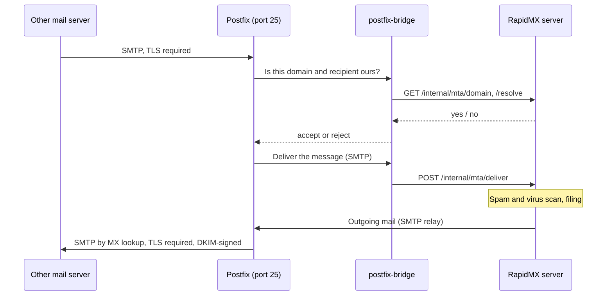

# Mail transport

The RapidMX server doesn't speak SMTP to the internet itself. It hands that job to a dedicated mail transfer agent and
talks to it over a small internal API. There are two transports to choose from:

- **Postfix with postfix-bridge**, which the Helm chart and the single-server installer install for you. It receives
  mail on port 25 and delivers your outgoing mail directly to recipients' servers.
- **Amazon SES with ses-bridge**, which the AWS deployment uses. SES receives and sends the mail, which avoids running
  port 25 yourself.

This page explains how each one works, what it needs from you, and the settings around it: DKIM signing, TLS between
mail servers, and the sender verification the server relies on.

## How mail flows

**Inbound**, Postfix asks postfix-bridge whether it serves the recipient's domain and address before it accepts a
message, so mail for unknown addresses is refused during the SMTP conversation. Accepted mail is handed to the server,
which scans it with rspamd and ClamAV and files it.

**Outbound**, the server relays each message to Postfix (the chart's `mail.relay.*`, port 25 on the cluster network).
Postfix signs it with the domain's DKIM key and delivers it by MX lookup. A delivery that fails bounces back to the
sender's mailbox.

The hand-off API lives at `/internal/mta` on the server and is authenticated with a shared bearer secret,
`mail:transport:ingest:secret` (Helm `global.mailIngestSecret`, Compose `MAIL_INGEST_SECRET`). postfix-bridge must have
exactly the same value. The public Gateway always answers `404` for `/internal`, and the server refuses a request to it
that carries proxy headers, so it can't be reached from the internet.

## Postfix and postfix-bridge

### On Kubernetes and k3s

The chart installs postfix-bridge as its `postfixBridge` subchart and wires it up: the ingest secret, the address of
the server, and the DKIM volume. You set two things:

| Value | Default | What it is |
| --- | --- | --- |
| `postfixBridge.hostname` | `mail.<global.domain>` | Postfix's public host name: its HELO name, the name on its TLS certificate, and the name your MX records point at |
| `postfixBridge.domains` | `<global.domain>` | Comma-separated domains Postfix knows when it starts |

Domains are the server's to manage. Add one in the admin console and, within about 10 seconds, Postfix accepts mail for
it, lets the server send as it and signs its mail with the DKIM key the console shows. Nothing restarts.
`postfixBridge.domains` is only the starting set. Removing a domain in the console stops it sending at once.

The `postfix` Service is a `LoadBalancer` on port 25. Postfix has to reach the internet on port 25 too, so check that
your provider allows outbound port 25 (see [Before you deploy](../getting-started/before-you-deploy.md#outbound-port-25)).

:::danger Keep the client address real
Port 25 is both your MX and the cluster's own outbound relay. Postfix tells the two apart by the client's address:
clients in `postfix.internalNetworks` (by default the private ranges, so the pod and node networks) may relay anywhere,
and everyone else may only send to domains the server accepts. That only holds if Postfix sees the real client
address, which is why the `postfix` Service uses `externalTrafficPolicy: Local`. With `Cluster`, k3s' ServiceLB shows
every internet client as an internal address, and **Postfix becomes an open relay**. Behind another load balancer,
check the address Postfix logs for an outside connection before you open port 25.
:::

### TLS between mail servers

Postfix **requires** TLS in both directions: other servers must use TLS to deliver to it, and it only delivers to
servers that offer TLS. Nothing arrives or leaves in the clear. The trade-off is that a server that can't do TLS can't
exchange mail with yours. The only plaintext hop is Postfix to postfix-bridge, inside the cluster.

Postfix's certificate comes from, in order:

1. `postfixBridge.tls.existingSecret`: a `kubernetes.io/tls` Secret you name. The single-server installer sets it to
   `mail.example.com-tls-cert`, the certificate the chart already issues for the web app, so Let's Encrypt isn't asked
   for a duplicate.
2. cert-manager, through the chart's own Issuer (`postfixBridge.tls.certManager.enabled`, on by default).
3. A self-signed certificate, with `postfixBridge.tls.certManager.enabled=false`.

### Postfix as a separate release

Set `postfixBridge.create=false` to install the [postfix-bridge chart](https://github.com/rapidmx/postfix-bridge) as a
release of its own. Nothing keeps separate releases in step, so give it:

- `ingestSecret`: the exact value of the server's `mail.ingestSecret`, which `helm get notes` tells you how to read;
- `ingestBaseUrl`: the server's Service, `http://rapidmx-server-services/internal/mta`;
- `hostname` and `domains`;
- `dkim.storage.existingClaim`: the server's DKIM claim, `rapidmx-server-dkim-keys`, so Postfix signs with the keys the
  server publishes in DNS;
- `tls.existingSecret`, or `tls.certManager.enabled=false`.

### With Docker Compose

The [production Compose setup](../getting-started/docker-compose.md#run-docker-compose-in-production) runs
postfix-bridge's own Compose stack in the same project. Its settings are `MAIL_HOSTNAME`, `MAIL_DOMAINS`,
`MTA_INGEST_BASE_URL` and `MTA_INGEST_SECRET`. Two differences from Kubernetes:

- `MAIL_DOMAINS` is the list of domains Postfix lets the server **send** from. Keep it in step with the admin console,
  and restart Postfix after changing it. Inbound acceptance follows the console without a restart.
- The Compose stack's Postfix doesn't sign with the server's DKIM keys yet. It signs with a key it generates itself,
  which doesn't match the record the admin console asks you to publish. Use Kubernetes or the single-server installer
  if you need DKIM to verify.

## DKIM

DKIM signatures let receiving servers check that mail claiming to be from your domain really came from you. RapidMX
generates a key pair for each domain when you add it, shows the public key as a DNS record in the domain's checklist,
and writes the private key to the DKIM volume, where Postfix reads it.

| Setting | Default | What it is |
| --- | --- | --- |
| `mail.dkim.selector` | `mail` | The selector, so the record is `mail._domainkey.example.com` |
| `mail.dkim.autogenerate` | `true` | Generate keys |
| `mail.dkim.storage` | `ReadWriteOnce`, `1Gi` | The volume both the server and Postfix mount |

Because both pods mount the same `ReadWriteOnce` volume, the server and Postfix must run on the same node. The DKIM
keys can't be recreated: back them up, see [Backup and restore](backup-and-restore.md).

### Key rotation

The server rotates the DKIM keys it made itself, per domain, so an old or leaked key doesn't stay good forever. A domain
signs with the global selector until its first rotation. Each rotation then makes a new selector, `rmx<yyyymmdd>`, and
moves through these phases:

1. The new record is published, by the [DNS provider](../administration/dns-publishing.md) the domain is assigned to, or
   shown on the domain's DNS checklist for you to add.
2. Signing switches once the record has been live for `publish_grace_hours` and Postfix has acknowledged the switch.
3. The old record stays published for `overlap_days`, and then the old record and key are removed.

Scheduled rotation is on by default, and needs postfix-bridge 1.6.0 or later, which the chart pins. With an older
postfix-bridge, turn it off. Keys imported by hand, deployments that send through SES and key providers that can't rotate
are never rotated. Start, pause or cancel a rotation in the domain's DKIM panel in the admin console.

| Setting | Default | What it is |
| --- | --- | --- |
| `mail:dkim:rotation:enabled` | `true` | Start rotations on schedule. Rotating by hand works either way. |
| `mail:dkim:rotation:interval_days` | `180` | Days before the next rotation starts |
| `mail:dkim:rotation:overlap_days` | `7` | Days the old record stays published after signing switches |
| `mail:dkim:rotation:publish_grace_hours` | `48` | Hours the new record must be live before signing switches |
| `mail:dkim:rotation:key_bits` | `2048` | RSA size of each new key, 2048 to 4096 |
| `mail:dkim:rotation:max_starts_per_run` | `10` | Rotations started per hourly run and server copy |

:::warning If you publish DNS by hand
After you upgrade to a release with rotation on by default, every domain older than `interval_days` starts a rotation
within the first runs. Its new `rmx<date>._domainkey` TXT record shows as missing on the domain's DNS checklist. Add it:
signing keeps using the old key until it is live. To opt out, set
`service.config.mail__dkim__rotation__enabled=false`.
:::

### Oversigning `Autocrypt` and `RapidMX-Key`

Outgoing mail announces each mailbox's keys in the `RapidMX-Key` and `Autocrypt` headers. A receiver only trusts those
headers when the message's DKIM signature **oversigns** them, which stops anyone adding a second copy after signing.
Your MTA's DKIM signing has to be configured to do this; otherwise, receivers that check ignore the headers. The
postfix-bridge 1.6.0 chart doesn't set it for you. Key lookups that don't use the headers, such as discovery and the Web
Key Directory, still work.

## Sender verification: `mail.trustedAuthservId`

Some features need to know that a message really came from the address in its From line: members-only distribution
lists, encryption key discovery, read receipts, calendar replies, message recalls and the e-mail challenges of
automatic signing certificates. The server learns that from the `Authentication-Results` header the inbound mail
system adds after checking DKIM, but only trusts the header carrying the right `authserv-id`.

- With the bundled Postfix, it is set for you, to `postfixBridge.hostname`.
- With any other inbound path (ses-bridge, your own MTA), set `mail.trustedAuthservId` (server setting
  `mail:security:trusted_authserv_id`) to the `authserv-id` your MTA stamps.

While it's empty, the server logs a warning at startup and fails closed: no sender is verified, so messages to
members-only lists are dropped, list and forwarding copies are sent with a rewritten From, forwarded invitations are
refused, and the features above ignore incoming mail. Your MTA must also remove any `Authentication-Results` header a
message arrives with before adding its own, or a sender could forge one.

## Amazon SES and ses-bridge

On AWS, the server sends through the SES API and receives through ses-bridge. The [AWS
guide](../getting-started/aws.md) sets this up end to end; this section explains the parts.

**Outbound.** With `mail.transport.provider=ses` and `postfixBridge.create=false`, the server hands each message to SES's
`SendEmail` API. Credentials come from the standard AWS credential chain: the node's IAM role, or an IAM role for the
pod's ServiceAccount (`global.serviceAccount.annotations` with `eks.amazonaws.com/role-arn`). There are no keys to
configure. The From address of every message must be on a verified SES identity, and the account must be out of the
SES sandbox to mail unverified recipients.

| Value | What it is |
| --- | --- |
| `mail.transport.ses.region` | The region SES sends from. Empty: the SDK's own resolution. |
| `mail.transport.ses.configurationSet` | An SES configuration set, for delivery, bounce and complaint event tracking |

**Inbound.** ses-bridge is a separate AWS CDK stack, deployed once per mail domain. SES receives the message, stores it
in S3 and invokes a Lambda function that checks each recipient against the server's `/internal/mta/resolve` and
delivers through `/internal/mta/deliver`. Unknown recipients are bounced after the message was accepted, because SES has
no way to refuse them during the SMTP conversation. The Lambda reaches the server through an internal load balancer
that `mail.ingestService.enabled` adds; restrict who can reach it with `mail.ingestService.loadBalancerSourceRanges`.

After each ses-bridge deploy, publish its three DKIM `CNAME` records, point the domain's MX record at SES, and activate
the receipt rule set. SES signs outgoing mail with its own (Easy DKIM) keys, so the DKIM row of the admin console's
checklist, which expects a RapidMX key, may stay red.

ses-bridge doesn't yet process SES bounce and complaint notifications, and it passes the ingest secret to the Lambda
as a plain environment variable.

## E-mail from the sign-in page

The auth-server sends sign-in codes and verification e-mail itself, over SMTP, with its own settings: the chart's
`global.smtp` values (the auth-server subchart can't read `mail.*`).

| Value | Default | With SES |
| --- | --- | --- |
| `global.smtp.host` | `postfix` | `email-smtp.<region>.amazonaws.com` |
| `global.smtp.port` | `25` | `587` |
| `global.smtp.ignoreTLS` | `true` (the hop to the bundled Postfix stays in the cluster) | `false` |
| `global.smtp.requireTLS` | `false` | `true` |
| `global.smtp.from` | `noreply@<global.domain>` | an address on a verified SES identity |

With SES, the auth-server also needs an SES SMTP user name and password, given as `smtp_config__auth__user` and
`smtp_config__auth__pass` from a Secret through `authserver.service.extraEnv`. The AWS installer does this from
`RAPIDMX_SES_SMTP_USERNAME` and `RAPIDMX_SES_SMTP_PASSWORD`.

:::note
The auth-server copies its SMTP settings into its database the first time it uses them; after that, its admin
console's Messages page owns them, and changing the chart values doesn't reach a running deployment by itself.
:::
