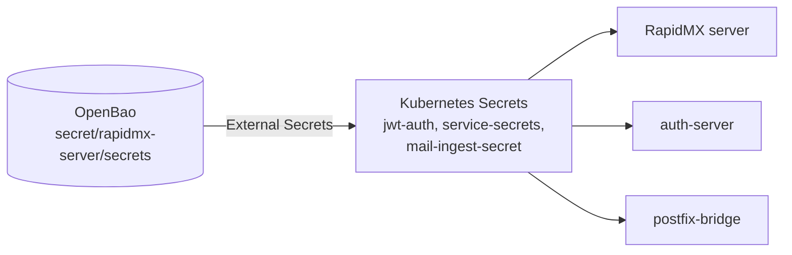

# Secrets and OpenBao

A RapidMX deployment has a handful of secrets that hold it together: the key that signs sign-in tokens, the secret
postfix-bridge uses to hand mail to the server, the keys behind cookies and sessions, and the key that makes the escrow
audit log tamper-evident. They have to be the same on every copy of the server, the same on both ends of each
connection, and stable across upgrades. Change one by accident and everyone is signed out, mail stops arriving, or
the escrow audit log stops verifying.

By default the Helm chart keeps them in Kubernetes Secrets. The single-server and AWS installers go one step further
and keep them in [OpenBao](https://openbao.org), an open-source secrets vault, from which
[External Secrets](https://external-secrets.io) copies them into the Kubernetes Secrets the pods read. This page
explains both.

## The secrets

| Secret | Shared with | Server setting | Without OpenBao | OpenBao field |
| --- | --- | --- | --- | --- |
| JWT secret | auth-server | `auth:secret` | `global.jwt.secret`, required | `auth_secret` |
| Mail ingest secret | postfix-bridge or ses-bridge | `mail:transport:ingest:secret` | `global.mailIngestSecret`, required | `mail_ingest_secret` |
| Cookie secret | — | `cookie_secret` | generated once and kept | `cookie_secret` |
| Session secret | — | `session:secret` | generated once and kept | `session__secret` |
| Escrow audit key | none | `mail:escrow:audit_hmac_key` | generated once and kept | `escrow_audit_hmac_key` |

Other Secrets the chart generates once and keeps: the rspamd controller password (`<fullname>-rspamd`) and the TURN
secret (`<fullname>-coturn`). The auth-server keeps the `admin` account's initial password in
`<release>-authserver-service-secrets`.

:::danger Never change the escrow audit key
Every entry of the escrow audit log is chained under this key. Entries chained under an old key no longer verify. The
chart refuses to render when you set a different key than the one stored, and OpenBao's copy is written once and never
replaced.
:::

## Without OpenBao (the chart's default)

You supply two secrets and the chart generates the rest:

- **`global.jwt.secret`** is required while the bundled auth-server is installed. Each side reads the same value; left
  out, each would generate its own and the server would reject every sign-in.
- **`global.mailIngestSecret`** is required. It can't be generated, because postfix-bridge must be given the same value.

Pass both again on every upgrade, or use `helm upgrade --reset-then-reuse-values`. The cookie, session and escrow audit
secrets are generated on install into `<fullname>-service-secrets` and read back on every upgrade. To manage those
yourself, set `global.secrets.cookies`, `global.secrets.sessions` and `mail.escrow.auditHmacKey`, or point
`global.secrets.existingSecret` at a Secret with the keys `cookie_secret`, `session__secret` and
`mail__escrow__audit_hmac_key`.

### Rendering without cluster access

Generating a secret once and keeping it needs the chart to read the existing Secret, which `helm template`, `--dry-run`
and GitOps tools like Argo CD and Flux can't do. Rather than generate new secrets on every render (and sign everyone
out on every sync), the chart fails with a message naming what to set. Set the values above explicitly, along with
`mail.rspamd.controller.password` or `mail.rspamd.controller.existingSecret`, and `coturn.auth.sharedSecret` or
`coturn.auth.existingSecret`.

## With OpenBao

With `global.openbao.enabled=true`, the release reads its secrets from OpenBao, at `global.openbao.kvMount` (default
`secret`), path `global.openbao.secretsPath` (default `<fullname>/secrets`). External Secrets copies them into the same
Kubernetes Secrets the pods already load, so nothing in the application changes. The bundled auth-server reads the
same path, so both sides share one JWT secret without either value being passed in, and upgrades need no secrets at
all.



**OpenBao and External Secrets are prerequisites, like cert-manager.** The chart installs neither, which is why the
value is off by default. External Secrets' CRDs are cluster-wide, so the chart can't bring them, and the render fails
with the command to install it when it's missing.

### What the installers set up

The single-server installer (`--openbao true`, the default) and the AWS installer (`EnableOpenBao`, on by default):

1. Install OpenBao in the `openbao` namespace, standalone with file storage on a volume, and External Secrets.
2. Initialise the vault with a single unseal key, and keep the key and the root token in the **`openbao-keys`** Secret
   in the `openbao` namespace.
3. Run an **`openbao-unsealer`** Deployment that unseals the vault within about ten seconds whenever it comes back
   sealed: after a pod restart, an upgrade or a reboot.
4. Write the release's secrets into the kv v2 mount `secret`, at `<fullname>/secrets`. A value already there always
   wins, so a re-run never re-keys anything.
5. Create a PKI mount (`pki`) with a root CA, and an issuing role (`rapidmx-encryption`) for the server's mail
   encryption certificates.
6. Create two tokens with narrow policies, each in a Secret in the release namespace: `<fullname>-openbao-eso`, which
   may only read the release's secrets (used by External Secrets), and `<fullname>-openbao-pki`, which may only sign and
   revoke on the PKI role.

Read the release's secrets with the root token from `openbao-keys`:

```bash
kubectl -n openbao exec -it openbao-0 -- env BAO_TOKEN=<root token> bao kv get -mount=secret rapidmx-server/secrets
```

:::warning The trade-off of auto-unsealing
Keeping the unseal key in a Secret is what lets the deployment heal itself after a reboot. The cost is that anyone who
can read Secrets in the `openbao` namespace can unseal the vault. **Back up the `openbao-keys` Secret**: without it,
nothing in the vault can be recovered. A cluster with a KMS to auto-unseal from should run its own vault and point the
chart at it instead.
:::

### Using an OpenBao you already run

Point the chart at it with `global.openbao.address`, and the installers with `OPENBAO_ADDRESS` (single server) or
`RAPIDMX_OPENBAO_ADDRESS` (AWS); they then install and prepare nothing. Your vault must hold, under
`global.openbao.kvMount` at `global.openbao.secretsPath`, the fields `auth_secret`, `cookie_secret`, `session__secret`,
`escrow_audit_hmac_key` and `mail_ingest_secret`. Generate each once, for example with `openssl rand -hex 32`.

Authenticate External Secrets in one of two ways:

- **A token** (`global.openbao.auth.method=token`, the default): `global.openbao.auth.tokenSecret` names a Secret
  (default `<fullname>-openbao-eso`) whose `token` key may read that path.
- **Kubernetes auth** (`global.openbao.auth.method=kubernetes`), which stores no token at all: set
  `global.openbao.auth.kubernetes.role` to an OpenBao role bound to the namespace's ServiceAccount, and
  `global.openbao.auth.kubernetes.mountPath` and `.serviceAccount` if they differ from `kubernetes` and `default`.

If `escrow_audit_hmac_key` is missing from a path you made by hand, its ExternalSecret reports `SecretSyncedError` and
the Secret stops being refreshed. Add the field before upgrading.

### The encryption certificate authority

The server issues users' encryption certificates from a certificate authority. Its backend is the server setting
`mail:pki:backend`:

- `local` (the server's default): a CA key kept on the PKI volume, `/var/lib/rapidmx/pki`.
- `openbao`: an OpenBao PKI mount. The server sends each certificate signing request to the vault, so the CA's private
  key never leaves it. It needs `mail:pki:openbao:address`, `:mount`, `:role` and a token in
  `mail__pki__openbao__token` that may `update` on `<mount>/sign/<role>` and `<mount>/revoke`.

To see which backend your server runs with, open **Diagnostics** in the admin console and look up `mail:pki:backend` in
the **Configuration** table. See [Server configuration](configuration.md#encryption-certificates) for every
`mail:pki:*` setting.

## Rotating secrets

| Secret | Effect of changing it |
| --- | --- |
| JWT secret | Everyone is signed out. Change it on both the server and the auth-server at once (one value with the chart). |
| Cookie and session secrets | Everyone is signed out. |
| Mail ingest secret | Mail stops flowing until postfix-bridge (or ses-bridge) has the new value too. |
| Escrow audit key | Don't. The escrow audit log stops verifying. To rotate on purpose, first remove `mail__escrow__audit_hmac_key` from the `<fullname>-service-secrets` Secret, as the chart's error message explains. |

Without OpenBao, change a secret by passing the new value to `helm upgrade`. With OpenBao, write the new value into the
vault; External Secrets picks it up within `global.externalSecrets.refreshInterval` (default `1m`), and the pods read it
when they next restart (`kubectl -n rapidmx rollout restart deploy/rapidmx-server-services`).
